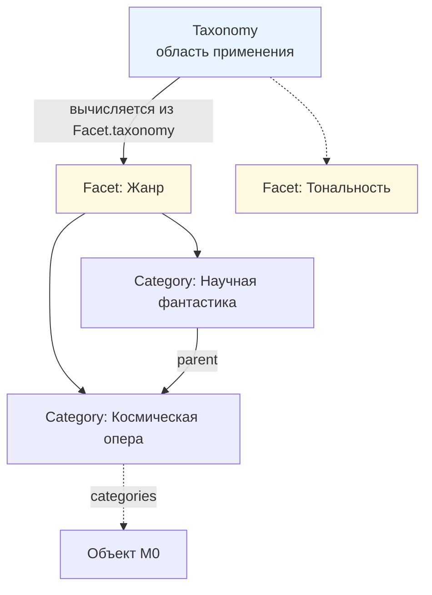

# ADR-0005: Классификация

## 1. Контекст и проблема

Черновики описывают классификацию тремя несовместимыми способами:

| Источник | Цепочка | Где настройки иерархии |
|---|---|---|
| Спецификация §7–8 («утверждён») | Таксономия → Категория → Объект | на Таксономии |
| Метамодель v1.0 §6–7 («утверждён») | Таксономия → Категория → Объект | на Таксономии |
| Метамодель v1.1 §7 (черновик) | Таксономия → Фасет → Категория → Назначение | на Фасете |

Дополнительно не определены:
- статус групп из Спецификации §5 («Знание», «Произведение», «Коллекция», «Источник», «Контекст»,
  «Деятельность», «Медиаматериал») — это объекты метамодели, ветки наследования или просто заголовки (C-19);
- положение `Персонаж`, объявленного «самостоятельным типом», но отсутствующего в классификации (C-16);
- признак абстрактности типа, из-за чего `Произведение` одновременно «не обязательно создаваемая заметка»
  и цель ссылки в `рекомендуемый_субъект` (C-17);
- критерий различения `Видео`/`Фильм` и `Аудио`/`Музыкальный трек` (C-18);
- физическое хранение ссылки на тип в экземпляре — строка или wikilink (C-09);
- реестр `TYPE_PREFIX`, который уже используется в примерах, но не утверждён (C-07).

## 2. Рассматриваемые варианты

### 2.1. Число уровней классификации

| # | Вариант | Плюсы | Минусы |
|---|---|---|---|
| A | 3 уровня: Taxonomy → Category → Object | Проще; соответствует «утверждённой» спецификации | Невозможно выразить независимые измерения (жанр, тональность, место действия) с разными правилами иерархии |
| **B** | **4 уровня: Taxonomy → Facet → Category → Object** | Каждое измерение несёт свои настройки; онтологически корректно | На один уровень больше объектов |
| C | 2 уровня: Facet → Category | Минимум сущностей | Теряется группировка фасетов по областям применения |

### 2.2. Объём предметных типов в утверждаемом ядре

| # | Вариант | Плюсы | Минусы |
|---|---|---|---|
| A | Все 43 типа из Спецификации §5 | Ничего не теряем | Ядро необозримо; редкие типы тянут за собой свойства |
| **B** | **6 абстрактных + 8 конкретных; остальные добавляются как данные M1** | Ядро проверяемо; механизм добавления типа уже отработан (S1) | Часть типов появится позже |
| C | Только 6 абстрактных | Минимальное ядро | Не на чем проверить схему |

### 2.3. Хранение типа в экземпляре

| # | Вариант | Плюсы | Минусы |
|---|---|---|---|
| **A** | **Строка: `type: book`** | Компактно; Bases фильтрует по тексту; быстрая валидация по реестру | Нет штатного ребра «экземпляр → тип» в графе Obsidian |
| B | Wikilink на объект `ObjectType` | Полная интеграция: backlinks, граф | Многословно; Bases получает свойство-ссылку; дублирует `type_prefix` в имени файла |
| C | Строка + вычисляемое `type_ref` | И то и другое | Нарушает принцип «один факт — одно место», только что применённый к `Taxonomy.facets` |

## 3. Решение

### 3.1. Четырёхуровневая классификация (вариант B)



1. `Taxonomy` хранит **только** `applicable_types` (к каким типам объектов применима) и системный контракт.
2. `Facet` хранит `taxonomy` (ссылка вверх), `hierarchy_mode`, `assignment_cardinality`, `root_requirement`.
3. `Category` хранит `facet` (ссылка вверх) и `parent`.
4. Объект M0 хранит плоский список `categories`.
5. **Все ссылки направлены только вверх.** Обратные (`Taxonomy.facets`, `Facet.categories`) — вычисляемые.
   Закрывает C-15: один факт хранится в одном месте.
6. Таксономия **может** задавать значения по умолчанию для `hierarchy_mode`, `assignment_cardinality`,
   `root_requirement`; фасет наследует их, если собственное поле пустое. Закрывает C-14 и открытый вопрос №6 v1.1.

### 3.2. Абстрактные и конкретные типы

Вводится обязательное поле `ObjectType.is_abstract: boolean`.

- **Абстрактный тип** — цель наследования, экземпляры не создаются. `type_prefix` у абстрактного типа
  **отсутствует** (`null`): префикс нужен только для имени файла, а файла у абстрактного типа нет.
- **Конкретный тип** — может иметь экземпляры. `type_prefix` обязателен и уникален.
- Плагин не предлагает абстрактные типы при создании объекта и при выборе типа из пустой ссылки.
- `RelationType.subject_types` / `object_types` **могут** ссылаться на абстрактные типы: это означает
  «любой наследник». Закрывает C-17 — `Произведение` как цель рекомендации становится законным.

Группы из Спецификации §5 получают статус **абстрактных типов M1** (закрывает C-19):

| Группа spec §5 | Абстрактный тип | `type` | Наследники в MVP |
|---|---|---|---|
| Контекст | `Context` | `context` | `Person`, `Character` |
| Деятельность | `Activity` | `activity` | `Project`, `Task` |
| Знание | `Knowledge` | `knowledge` | — (отложено) |
| Произведение | `Work` | `work` | `Book`, `Chapter` |
| Коллекция | `Collection` | `collection` | — (отложено) |
| Источник | `Source` | `source` | `Article` |
| Медиаматериал | — | — | тип `MediaAsset` относится к системному слою M1, не к предметному |
| Системные | — | — | 11 типов M1, `layer: system` |

### 3.3. Состав ядра предметных типов (вариант B, 8 конкретных)

| Тип | `type` | `type_prefix` | Родитель | Обоснование включения |
|---|---|---|---|---|
| `Person` | `person` | `PERSON` | `Context` | ядро любой БЗ |
| `Character` | `character` | `CHAR` | `Context` | Q-15 = A; домен — художественные произведения |
| `Project` | `project` | `PROJ` | `Activity` | ядро PKM |
| `Task` | `task` | `TASK` | `Activity` | ядро PKM |
| `Book` | `book` | `BOOK` | `Work` | основной тип домена |
| `Chapter` | `chapter` | `CHAP` | `Work` | проверяет иерархию «часть → целое» внутри `Work` |
| `Article` | `article` | `ARTICLE` | `Source` | основной источник |
| `Organization` | `organization` | `ORG` | `Context` | цель ссылочных свойств (`publisher`) |

**Отложено (добавляется как данные M1 без ADR и без релиза):** `Place`, `Event`, `Goal`, `Problem`,
`WebNovel`, `Film`, `Series`, `Episode`, `Track`, `Album`, `Poem`, `Lyrics`, `VideoGame`, `WebPage`,
`Video`, `Audio`, `Concept`, `Idea`, `Note`, `Hypothesis`, `Conclusion`, `Decision`, `Franchise`,
`BookSeries`, `FilmSeries`, `MusicSeries`, `Gallery`.

> Предложение ассистента к рассмотрению: заменить `Organization` на `Idea` — см. открытый вопрос Q-21.

### 3.4. `Character` — наследник `Context` (Q-15 = A)

- Иерархия: `Context` → `Character`. Переиспользует свойства контекста (имя, описание, медиа).
- Связь с произведением: тип отношения `appears_in` (`Character` → `Work`), кардинальность `0..n`.
- Различие «реальный человек / вымышленный персонаж» выражается **местом в иерархии**, а не значением
  свойства: у `Person` и `Character` разные наборы свойств (у `Character` есть `appears_in`,
  у `Person` — `professions`, `affiliations`).
- `type_prefix` = `CHAR` (исправлена кириллическая «Е» в `CHARACTЕR`, C-06).

### 3.5. Критерий различения `Source` и `Work` (Q-16 = B)

| | `Source` | `Work` |
|---|---|---|
| **Что это** | То, откуда извлечена информация | Самостоятельное произведение |
| **Характерные свойства** | `url`, `accessed_at`, `publisher`, `author` | `creator`, `publication_date`, `language` |
| **Может входить в `Collection`** | нет | да |
| **Пример** | видеозапись лекции, статья, веб-страница | фильм, книга, трек |

**Проверка различимости:** «фильм, на который написана рецензия» → `Work`.
«видеозапись лекции, из которой вынесена концепция» → `Source`.
Если объект значим обоими способами — создаются два объекта со связью `derived_from` (`Work` → `Source`).

Закрывает C-18: `Video`/`Audio` остаются в `Source`, `Film`/`Track` — в `Work`, пересечение устранено
критерием, а не слиянием типов.

### 3.6. Поле `type` — строка (Q-17 = A)

1. Экземпляр хранит `type: <значение snake_case>`, например `type: book`.
2. Значение проверяется по реестру типов (индекс плагина), а не разрешением ссылки.
3. `type_prefix` уже входит в имя файла каждого объекта — техническая часть `(BOOK-01J8Z6…)` даёт
   штатный разрешимый след, поэтому отдельный wikilink избыточен.
4. Иерархию типов плагин строит по собственному индексу объектов `ObjectType`, а не по графу Obsidian.

**Осознанная потеря:** в стандартном графе Obsidian нет рёбер «экземпляр → его тип».
Компенсация: плагин предоставляет собственное представление иерархии типов (модуль фазы 5).

Закрывает C-09. Вариант C отклонён как нарушение принципа «один факт — одно место».

### 3.7. Реестр префиксов

Реестр — **производный артефакт**: источник истины — поле `type_prefix` в объектах `ObjectType`.
`docs/metamodel/TYPE_PREFIX_REGISTRY.md` — человекочитаемый снимок для проверки уникальности на ревью.
Закрывает C-07. Правила: ASCII `[A-Z][A-Z0-9]*`, длина 3–12, уникальность по точному совпадению строки,
префикс обязателен только для конкретных типов.

## 4. Обоснование

1. **Четыре уровня** — единственная схема из трёх, способная выразить независимые измерения классификации
   с разными правилами. Это решение уже было принято в v1.1; ADR доводит его до согласованного вида.
2. **Ссылки только вверх** устраняют класс ошибок рассинхронизации и сокращают объём данных.
3. **`is_abstract`** — штатный механизм вместо неопределённого статуса «концептуальный уровень».
4. **8 конкретных типов** покрывают все ветки наследования, оба режима иерархии, оба вида связей
   и медиа — достаточно, чтобы проверить схему, не раздувая ядро.
5. **Строковый `type`** согласуется с тем, как Bases читает свойства (`BasesPropertyType = 'note'`),
   и не создаёт второго источника истины.

## 5. Последствия

### Положительные
- Классификация становится проверяемой: у каждого назначения категории можно определить фасет,
  а у фасета — правила кардинальности.
- Добавление новых предметных типов не требует ни ADR, ни релиза плагина.
- Устранено 8 позиций реестра диагностики.

### Отрицательные / стоимость
- Уровень `Facet` обязателен даже для простых классификаций: чтобы завести один жанр, нужны
  Taxonomy + Facet + Category — три объекта. **Митигция:** плагин создаёт их одной командой
  («Новая классификация») с разумными значениями по умолчанию.
- В графе Obsidian не будет рёбер «экземпляр → тип» (осознанная потеря, §3.6).
- `type_prefix` у абстрактных типов отсутствует — значит, абстрактный тип нельзя использовать
  как цель ссылки по префиксу. Это согласуется с запретом создавать его экземпляры.

### Что становится возможным позже
- Пакетная поставка классификаций (идея E4 из Exocortex): таксономия «Жанры кино» как импортируемый набор.
- Экспорт в SKOS: `Taxonomy` → `skos:ConceptScheme`, `Category` → `skos:Concept`,
  `parent` → `skos:broader`. Совпадение структур полное, конвертация тривиальна.

## 6. Влияние на метамодель

| Элемент | Было | Стало | Тип изменения |
|---|---|---|---|
| Уровни классификации | 3 или 4 (противоречие) | 4: Taxonomy → Facet → Category → Object | **BREAKING** для v1.0/spec (C-13) |
| `Taxonomy.hierarchy_mode`, `assignment_cardinality`, `root_requirement` | основные поля | значения по умолчанию, наследуемые фасетом | changed (C-14) |
| `Taxonomy.facets` | хранимое поле (v1.1) | вычисляемое | **BREAKING** (C-15) |
| `ObjectType.is_abstract` | отсутствовало | обязательное boolean | additive (C-17) |
| `ObjectType.layer` | отсутствовало | обязательный enum `system` \| `domain` | additive (C-19) |
| `ObjectType.type_prefix` | подразумевался | обязателен для конкретных, `null` для абстрактных | additive (C-07) |
| `Character` | вне классификации, префикс с кириллицей | наследник `Context`, префикс `CHAR` | clarification (C-16, C-06) |
| `type` у экземпляра | не определён способ хранения | строка snake_case | clarification (C-09) |
| `Source` / `Work` | пересекались | критерий различения зафиксирован | clarification (C-18) |

## 7. Миграция

- Требуется: да, отложена. Существующих объектов M0 и определений M1 в хранилище нет.
- Что нужно сделать при наполнении: категории, созданные по модели v1.0 (со ссылкой `таксономия`),
  получают ссылку `facet`; для каждой таксономии v1.0 создаётся один фасет-наследник.
- Когда: фаза 3–4.

## 8. Артефакты

- `docs/metamodel/TYPE_PREFIX_REGISTRY.md` (new)
- `docs/metamodel/00_overview.md` (new)
- `docs/metamodel/01_diagnosis.md` (обновлён статус закрытых позиций)

## 9. Связанные документы

- Decision log: D-0017, D-0018, D-0019, D-0020
- Changelog: 0.4.0
- Другие ADR: ADR-0001 (имена), ADR-0002 (идентичность), ADR-0003 (свойства)
- Диагностика: C-06, C-07, C-09, C-13, C-14, C-15, C-16, C-17, C-18, C-19

## 10. Сообщение коммита

```
docs(adr): ADR-0005 classification — 4 levels, abstract types, Source/Work criterion
```
