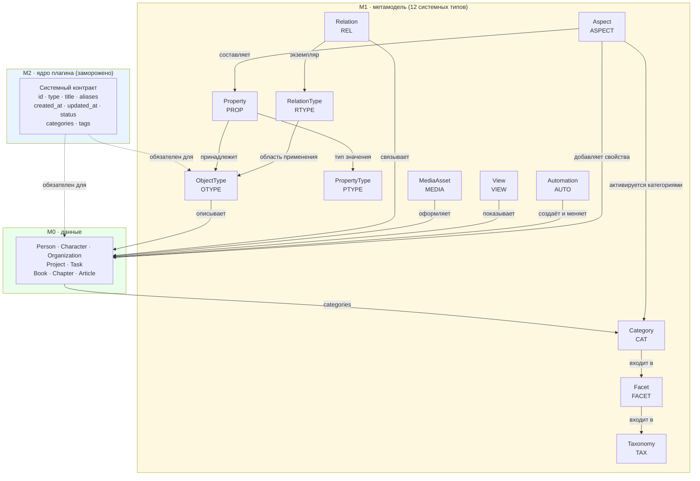
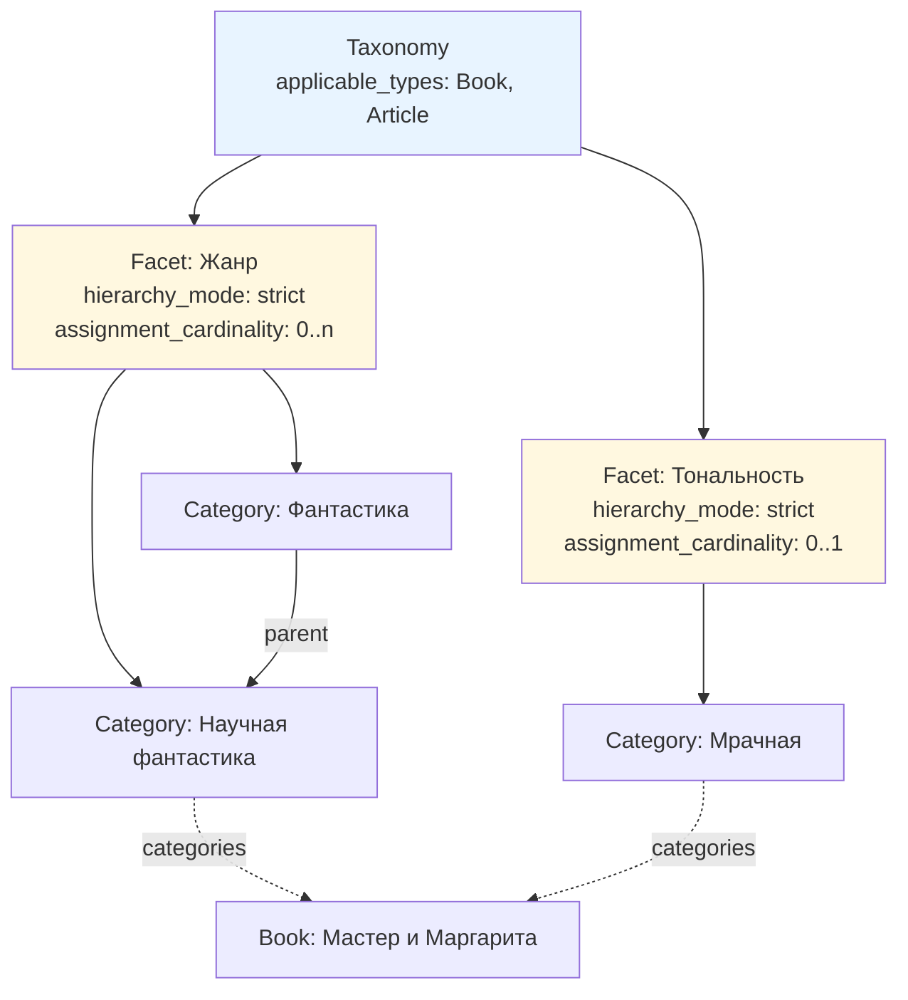

# Метамодель Second Brain: общее описание и классификация

> **Статус:** `draft`. Все разделы зафиксированы решениями ADR-0001…ADR-0008.
> **Ядро M1 полное**: все 12 типов имеют определённое поведение (ADR-0001…ADR-0011).
> Незакрытым остался только шаг 7 — расслоение документов (C-36…C-38, C-41).

---

## 1. Три уровня модели

Метамодель разделена на три уровня. Смешение уровней было причиной значительной части противоречий
в исходных черновиках (C-19, C-35).

| Уровень | Что описывает | Кто изменяет | Где хранится | Изменяемость в MVP |
|---|---|---|---|---|
| **M2** | Правила устройства метамодели: состав системного контракта, допустимые форматы кардинальности, алгоритм наследования, правила валидации | разработчик плагина, с релизом | код плагина + JSON Schema в репозитории | **заморожен** |
| **M1** | Определения: типы объектов, свойства, типы отношений, таксономии, фасеты, категории, представления, автоматизации | пользователь, через UI плагина или правкой заметок | заметки vault, Markdown + YAML | расширяем без релиза |
| **M0** | Экземпляры: книги, люди, проекты, идеи | пользователь | заметки vault, Markdown + YAML | — |

**Принцип:** M2 замораживается намеренно. Возможность редактировать правила устройства метамодели
из хранилища превращает модель в бесконечную самореференцию и лишает плагин инвариантов,
на которые можно опереться.

### 1.1. Источник истины и производные слои

| Слой | Источник истины | Производное |
|---|---|---|
| M0 данные | Markdown + YAML frontmatter | индекс в памяти плагина |
| M1 метамодель | **Markdown + YAML frontmatter** | `.sb/cache/*.json` — пересобираемый кэш, не редактируемый |
| M2 ядро | код плагина + JSON Schema | — |

Кэш удаляем и пересобираем. Штатное редактирование M1 — через UI плагина, который пишет в те же
Markdown-файлы (сохраняется требование v1.1 §15.4). Техническое обоснование: Bases читает свойства
из frontmatter (`BasesPropertyType = 'note'`), поэтому Markdown-источник совместим с Bases напрямую.

---

## 2. Системный контракт объекта

Поля, которые есть у **каждого** объекта M0 и M1. Задаются кодом плагина (M2), а не метамоделью,
и не могут быть переопределены как обычные свойства.

| Поле | Тип | Обяз. | Формат | Описание |
|---|---|---|---|---|
| `id` | string | да | ULID, 26 символов | Единственный носитель идентичности. Не меняется никогда, не переиспользуется |
| `type` | string | да | snake_case, из реестра | Идентификатор типа. Проверяется по индексу, не разрешением ссылки |
| `title` | string | да | свободный, ≤ 60 симв. для имени файла | Единственный источник отображаемого названия |
| `aliases` | string[] | нет | — | Только реальные псевдонимы. Порядок не значим (ADR-0004) |
| `created_at` | datetime | да | ISO 8601 с offset | Дата создания |
| `updated_at` | datetime | да | ISO 8601 с offset | Дата последнего изменения |
| `status` | enum | да | см. §8.1 | Стадия жизненного цикла данных |
| `tags` | string[] | нет | — | Свободные метки Obsidian. **Не валидируются** |
| `cat_<facet_key>` | string[] | нет | список ссылок на `Category` | Назначения категорий по осям. Состав полей определяется метамоделью (ADR-0007) |

**Две роли `title` (D-0063).** Поле `title` входит в контракт каждого объекта, но играет две роли:
**ключ** (EN snake_case) у определений, адресуемых по ключу — `Property`, `PropertyType`,
`RelationType`, `Facet`, `Aspect`, `Automation`; **отображаемое название** — у `ObjectType`,
`Relation`, `Taxonomy`, `Category`, `MediaAsset`, `View` и экземпляров предметных типов.
Норма и её следствия для правил `contract.r6`, `contract.r11`, `contract.r12` —
`NAME_MAPPING.md` §0.

**Расширяемый системный слой.** Поля `cat_*` не входят в фиксированное ядро контракта: их состав
порождается определениями `Facet`. Инварианты (формат имени, принадлежность категорий своему фасету,
кардинальность) обеспечивает ядро плагина. Это реализация решения v1.1 §14.1 «фиксированное ядро
системных атрибутов плюс расширяемый системный слой».

**Зарезервированное пространство имён.** Префикс `cat_` запрещён для `Property.key` (проверка `error`).

**Граница `tags` / `categories`** (закрывает неопределённость черновиков, где оба поля объявлены
обязательными без разграничения):

| | `tags` | `categories` |
|---|---|---|
| Природа | свободная метка Obsidian | ссылка на объект `Category` |
| Поле | одно фиксированное `tags` | по одному `cat_<facet_key>` на ось |
| Валидация | отсутствует | проверяется: существование, принадлежность своему фасету, кардинальность фасета |
| Иерархия | нет | есть, через `Category.parent` |
| Область применения | любая | ограничена `Taxonomy.applicable_types` |
| Колонка в Bases | одна | по колонке на ось |
| Когда использовать | быстрые непостоянные пометки, интеграция с плагинами Obsidian | устойчивая классификация |

---

## 3. Ядро M1: 12 системных типов



| Тип | `type` | Назначение | Ключевые поля сверх контракта |
|---|---|---|---|
| `ObjectType` | `object_type` | Определение типа объекта | `label`, `type_prefix`, `is_abstract`, `layer`, `parent_type`, `properties`, `property_overrides`, `description`; последовательности: `sequential_parent`, `sequence_key`, `sequence_step`, `sequence_direction`, `title_template` |
| `PropertyType` | `property_type` | Тип значения (6 значений, закрытый набор) | — |
| `Property` | `property` | Определение свойства | `label`, `value_type`, `cardinality`, `required`, `scope`, `target_types`, `target_facet`, `expected_media_roles`, `unique_within`, `allowed_values`, `definition`, `lifecycle` |
| `RelationType` | `relation_type` | Семантика связи | `label`, `forward_label`, `inverse_label`, `direction`, `subject_types`, `object_types`, `cardinality`, `uniqueness_rule`, `is_restriction` |
| `Relation` | `relation` | Реифицированная связь с атрибутами | `subject`, `relation_type`, `object`, `order`, `is_primary`, `valid_from`, `valid_to`, `source_ref`, `context`, `description` |
| `Taxonomy` | `taxonomy` | Область классификации | `label`, `applicable_types`, значения по умолчанию для фасетов |
| `Facet` | `facet` | Измерение классификации | `label`, `taxonomy`, `hierarchy_mode`, `assignment_cardinality`, `root_requirement` |
| `Category` | `category` | Значение внутри фасета | `label`, `facet`, `parent` |
| `MediaAsset` | `media_asset` | Медиафайл, его роли и метаданные | `label`, `file`, `media_kind`, `roles` (`0..n`), `galleries` (`0..n`, порядок не хранится), `cat_creation_method`, `source_url`, `author`, `license`, `description`. Технические метаданные не хранятся |
| `View` | `view` | Представление | `label`, `target_types`, `mechanism`, `definition`, `is_active` |
| `Automation` | `automation` | Автоматизация и форма создания | `label`, `trigger`, `mechanism`, `target_types`, `form_fields`, `defaults`, `require_confirmation`, `is_active` |
| `Aspect` | `aspect` | Набор свойств, активируемых категориями | `label`, `trigger_categories`, `properties`, `property_overrides`, `is_active`, `description` |

---

## 4. Классификация: четыре уровня



### 4.1. Правила

1. Ссылки хранятся **только вверх**: `Category.facet`, `Facet.taxonomy`. Обратные вычисляются.
2. Настройки иерархии и кардинальности назначения живут **на фасете**. У фасета есть обязательное
   поле `key` (EN snake_case, глобально уникальное) — оно образует имя поля назначений `cat_<key>`.
3. Таксономия задаёт **значения по умолчанию**, которые фасет наследует при пустом собственном поле.
4. Категория принадлежит **ровно одному** фасету. Перенос в другой фасет — контролируемая операция,
   поскольку меняет смысл назначения.
5. Корень определяется пустым `parent`. Искусственный объект «Корень» не создаётся.
6. Предки вычисляются обходом `parent` вверх.
7. Объект M0 хранит назначения **по полям на ось**: `cat_genre`, `cat_tone`, `cat_profession` (ADR-0007).
   Принадлежность оси видна из имени поля, разрешение ссылок не требуется.

### 4.2. Проверки целостности классификации

| ID | Уровень | Правило |
|---|---|---|
| `classif.r1` | error | Категория ссылается на существующий фасет |
| `classif.r2` | error | Тип объекта входит в `applicable_types` таксономии назначенной категории |
| `classif.r3` | error | Количество назначенных категорий фасета не нарушает `assignment_cardinality` |
| `classif.r4` | error | При `hierarchy_mode: strict` у категории не более одного `parent` |
| `classif.r5` | error | Цикл в `parent` отсутствует |
| `classif.r6` | warn | Корневых категорий больше, чем допускает `root_requirement` |
| `classif.r7` | warn | Категория без дочерних и без назначений — возможно, мёртвая |
| `classif.r8` | error | Названия категорий уникальны в пределах одного фасета |
| `classif.r9` | warn | Одно и то же название категории встречается в разных фасетах одной таксономии — вероятно нарушение ортогональности осей |
| `classif.r10` | error | Поле `cat_<key>` существует только для фасета с таким `key` |
| `classif.r11` | error | Каждая ссылка в `cat_<key>` ведёт на `Category`, у которой `facet.key == <key>` |
| `classif.r12` | warn | Обнаружено поле `cat_*` без соответствующего фасета — вероятно, фасет удалён или переименован |

Правила `classif.r8` и `classif.r9` введены по итогам сопоставления с канонической моделью
классификации (требование ортогональности фасетов). Обоснование — `docs/metamodel/02_concept_alignment.md` §4.1.

> **Терминологическое предупреждение.** Наша `Taxonomy` — это контейнер осей классификации,
> а не иерархия категорий. Иерархией является `Facet` со значением `hierarchy_mode: strict`.
> Соответствие каноническим понятиям «домен / таксономия / категория / фасет» —
> в `docs/metamodel/02_concept_alignment.md` §2.

---

## 5. Иерархия типов объекта

### 5.1. Абстрактные типы

| Абстрактный тип | `type` | Наследники в MVP | Отложено |
|---|---|---|---|
| `Context` | `context` | `Person`, `Character`, `Organization` | `Place`, `Event` |
| `Activity` | `activity` | `Project`, `Task` | `Goal`, `Problem` |
| `Work` | `work` | `Book`, `Chapter` | `WebNovel`, `Film`, `Series`, `Episode`, `Track`, `Album`, `Poem`, `Lyrics`, `VideoGame` |
| `Source` | `source` | `Article` | `WebPage`, `Video`, `Audio` |
| `Knowledge` | `knowledge` | — | `Concept`, `Idea`, `Note`, `Hypothesis`, `Conclusion`, `Decision` |
| `Collection` | `collection` | `Gallery` | `Franchise`, `BookSeries`, `FilmSeries`, `MusicSeries` |

Абстрактный тип: `is_abstract: true`, `type_prefix: null`, экземпляры не создаются,
не предлагается при выборе типа, **может** быть целью `subject_types` / `object_types`
в значении «любой наследник».

### 5.2. Конкретные типы MVP (9)

| Тип | `type_prefix` | Родитель | Включён, потому что |
|---|---|---|---|
| `Person` | `PERSON` | `Context` | ядро любой БЗ |
| `Character` | `CHAR` | `Context` | домен — художественные произведения |
| `Organization` | `ORG` | `Context` | цель ссылочного свойства `publisher` |
| `Project` | `PROJ` | `Activity` | ядро PKM |
| `Task` | `TASK` | `Activity` | ядро PKM |
| `Book` | `BOOK` | `Work` | основной тип домена |
| `Chapter` | `CHAP` | `Work` | проверяет иерархию «часть → целое» внутри `Work` |
| `Article` | `ARTICLE` | `Source` | основной источник |
| `Gallery` | `GALLERY` | `Collection` | кураторская подборка медиа (ADR-0011 §3.5) |

### 5.3. Критерий `Source` vs `Work`

| | `Source` | `Work` |
|---|---|---|
| Что это | откуда извлечена информация | самостоятельное произведение |
| Свойства | `url`, `accessed_at`, `publisher`, `author` | `creator`, `publication_date`, `language` |
| Входит в `Collection` | нет | да |
| Пример | видеозапись лекции | фильм |

Обе роли значимы → два объекта и связь `derived_from` (`Work` → `Source`).

### 5.4. Наследование свойств

Правила без изменений из Спецификации §14 (сильное решение S4):

**Дочерний тип может:** повысить обязательность · сузить кардинальность · добавить ограничение ·
добавить собственное свойство.

**Дочерний тип не может:** изменить смысл (`definition`) · изменить `value_type` ·
понизить обязательность · расширить кардинальность.

Нарушение — ошибка уровня `error`, обнаруживается при загрузке метамодели.

---

## 6. Три слоя имени

| Слой | Пример | Где хранится | Назначение |
|---|---|---|---|
| `key` | `publisher` | имя поля в YAML | канон для кода, JSON Schema, TS-типов |
| `label` | `Издательство` | поле `label` в определении M1 | подпись в UI плагина и `displayName` в Bases |
| `label_*` | `label_en: Publisher` | то же | локализации (задел, в MVP не заполняется) |

| Режим | Что видно | Кто обеспечивает |
|---|---|---|
| Source (исходный код) | `publisher:` | YAML |
| Панель Properties Obsidian | `publisher` | Obsidian, подписи нет |
| Модалка свойств плагина | «Издательство» | плагин, `label` |
| Bases (таблица) | «Издательство» | `displayName` в `.base`, проставляет плагин |
| Проводник, граф, поиск | «Мастер и Маргарита» | `title` + имя файла |

Переходный слой: плагин принимает исторические русские ключи по `NAME_MAPPING.md` с диагностикой `warn`,
пишет всегда английские. Отключение — настройкой `legacy_keys: false` после миграции.

---

## 7. Отношения, роли и профессии

Зафиксировано ADR-0006. Раздел 7.3 остаётся незакрытым (Q-27 → ADR-0008).

### 7.1. Гибридная модель связей («правило повышения», X-03)

1. По умолчанию связь хранится **ссылкой в свойстве** объекта: `author: "[[Михаил Булгаков (PERSON-…)|…]]"`.
2. Как только у связи появляется **хотя бы один атрибут** (период, порядок, источник, должность, роль) —
   она обязана стать объектом `Relation`, а ссылка в свойстве удаляется.
3. Одна связь **не может** существовать в двух формах одновременно. Проверяется валидатором.

Закрывает C-27. Атрибуты `Relation` специфицированы как обычные `Property` типа `Relation`
(`order`, `is_primary`, `valid_from`, `valid_to`, `source_ref`, `context`, `description`, `role`, `position`) —
закрывает C-30.

### 7.2. Правило роли

> Если факт относится к объекту **сам по себе** и устойчив — это **категория фасета**.
> Если факт связывает **два объекта** или несёт **атрибуты** — это **`Relation`**.

| Случай | Механизм | Где хранится | Атрибуты |
|---|---|---|---|
| Профессия | фасет `Profession` | `cat_profession` на объекте | — |
| Роль участия в произведении | `RelationType` на роль (`author`, `translator`, `illustrator`) | свойство-ссылка или `Relation` | `order`, `is_primary`, `valid_from/to`, `source_ref` |
| Роль персонажа | один `RelationType` `portrays` | `Relation` | `role` → `Category` фасета `Character roles` |
| Принадлежность к организации | `RelationType` `member_of` | `Relation` | `position`, `valid_from`, `valid_to` |
| Тип / роль организации | фасет `Organization type` (Q-28) | `cat_org_type` на объекте | — |

**Критерий выбора между «`RelationType` на роль» и «один `RelationType` + атрибут `role`:**
отдельный тип отношения — когда у роли своя семантика и свои обратные названия, а список ролей закрыт
(единицы). Атрибут `role` — когда роли однородны по структуре, а список открыт (десятки и больше).

Для атрибута `role` введено необязательное поле `Property.target_facet`: при `value_type: reference`
и `target_types: [category]` ограничивает допустимые значения одним фасетом. Без него значением роли
могла бы стать любая категория.

### 7.3. Активируемые свойства: `Aspect` (ADR-0008, закрывает R-TRIGGER)

Назначение категории может делать применимыми дополнительные свойства. Механизм — 12-й тип M1 `Aspect`:

```yaml
---
id: 01J8Z6M4K2Q7V9X3N5B0C1D3E1
type: aspect
title: literary_person
label: Литературная деятельность
trigger_categories:
  - "[[Писатель (CAT-01J8Z6…)|Писатель]]"
  - "[[Поэт (CAT-01J8Z6…)|Поэт]]"
properties:
  - "[[pen_name (PROP-01J8Z6…)|Псевдоним]]"
  - "[[literary_period (PROP-01J8Z6…)|Литературный период]]"
is_active: true
---
```

Значения активируемых свойств хранятся **в плоском frontmatter самого объекта** — отдельный
объект-«профиль профессии» не создаётся:

```yaml
# Михаил Булгаков (PERSON-01J8Z6…).md
---
type: person
title: Михаил Булгаков
cat_profession:
  - "[[Писатель (CAT-01J8Z6…)|Писатель]]"
  - "[[Врач (CAT-01J8Z6…)|Врач]]"
pen_name: []                                  # активировано «Писателем»
medical_specialization: "[[Венеролог (…)|…]]" # активировано «Врачом»
---
```

**Правила механизма:**

1. **Активация включает потомков категории.** «Романист» → «Прозаик» → «Писатель»: объект, отмеченный
   только «Романистом», получает литературные свойства. Иначе пришлось бы перечислять в триггере всю ветку.
2. **Алгоритм разрешения свойств, редакция 2** (изменяет ADR-0003 §3.4):
   `effective = union(inherited, own, universal, triggered)`; при переопределениях аспекты
   упорядочиваются **по возрастанию `id`** — детерминированно, результат не зависит от порядка обхода файлов.
3. **Конфликт двух аспектов** с несовместимыми ограничениями одного свойства — `error` **при загрузке
   метамодели**, а не при правке объекта. Вариант «побеждает строжайшее» отклонён: он маскирует
   ошибку проектирования.
4. **Значения не удаляются автоматически.** Снятие категории-триггера при заполненном свойстве —
   `warn` (`aspect.r1`), а не очистка. Принцип S6.
5. **Несколько профессий работают** через объединение аспектов. Множественное наследование типов
   при этом не требуется — именно поэтому профессия не может быть подтипом `Person`.

Задел: триггер позже расширяется на тип отношения, значение свойства и тип объекта
(`trigger_relation_types`, `trigger_conditions`, `trigger_types`) — аддитивно, семантика «ИЛИ».

### 7.4. Связи, введённые этим разделом

| `RelationType` | `subject_types` → `object_types` | Кардинальность | `uniqueness_rule` |
|---|---|---|---|
| `author` | `Work` → `Person` | `0..n` | `unique_triple` |
| `portrays` | `Character` → `Work` | `0..n` | `unique_triple` |
| `member_of` | `Person` → `Organization` | `0..n` | `unique_triple` |
| `appears_in` | `Character` → `Work` | `0..n` | `unique_triple` |
| `derived_from` | `Work` → `Source` | `0..n` | `unique_triple` |
| `supersedes` | любой → любой (новый заменяет старый) | `0..1` | `unique_subject` |
| `merged_into` | любой → любой (дубликат влит в основной) | `0..1` | `unique_subject` |

`subject_types` / `object_types` ссылаются на абстрактные типы в значении «любой наследник» (ADR-0005).
`is_restriction: false` — рекомендации, не запреты (сохранено из черновиков, «рекомендация ≠ запрет»).

### 7.5. Медиаобёртки (ADR-0011)

`MediaAsset` — **реификация** ссылки на файл: обёртка существует потому, что у связи файла с объектом
есть атрибуты (роли, источник, автор, лицензия, метод создания). `Relation` поверх обёртки означал бы
двойную реификацию и не вводится.

| Правило | Содержание |
|---|---|
| Связь с объектами | Через свойства объекта: `Book.cover`, `Person.portrait`, `Organization.logo`, `Book.illustrations`. Обёртка список объектов **не хранит**; обратный список **вычисляется** из имеющихся ссылок |
| Фильтрация кандидатов | `Property.expected_media_roles` — предлагаются только обёртки, у которых хотя бы одна роль совпадает |
| Роли | `roles`, `0..n`: `cover`, `banner`, `logo`, `portrait`, `avatar`, `preview`, `background`, `other` |
| Метод создания | Фасет `creation_method` (`key: creation_method`) + категории «Фото», «Коллаж», «Рисунок», «Генерация ИИ»; назначение в `cat_creation_method` |
| Аспект метода | `ai_generated_media` активирует `prompt`, `negative_prompt`, `model`, `seed`, `sampler`, `steps`, `source_image` |
| Галереи | `MediaAsset.galleries` (`0..n`). **Порядок не хранится** — это свойство представления (сортировка Bases). `Gallery` не имеет поля состава; состав вычисляется из обратных ссылок |
| Имя бинарного файла | `{title} ({MEDIA}-{id}).{ext}` — конвенция ADR-0002 распространена на бинарные файлы. Переименование только при создании и по явной команде |
| Граница применения | Обёртка нужна, только если изображению требуется роль или собственные метаданные. Иллюстрации в тексте остаются обычными `![[file.png]]` |
| Технические метаданные | Не хранятся: читаются по требованию и кэшируются в `.sb/cache/` |
| Разрешение | Обёртка разрешается в файл по стабильному `id`. При отсутствии результата — **сообщить, не выбирать произвольное изображение**. Разрешение не изменяет обёртку |

**Отклонения от черновика v1.1 §10, подтверждённые пользователем:** отдельный алгоритм контекстного
разрешения не вводится — его заменяют чтение свойства объекта и фильтрация кандидатов по ролям;
автозаполнение метаданных объекта из обёртки отложено; сетевой источник изображения вне MVP;
отрисовка в режиме правки перенесена на поздний этап.

> Технические подробности отображения (точки отрисовки, ограничения штатных таблиц, этапы) —
> в `docs/plugin/ARCHITECTURE.md`. Здесь они не приводятся согласно правилу расслоения L-1.

---

## 8. Перечисления

### 8.1. `status` — жизненный цикл данных (Спецификация §15)

`capture` → `draft` → `normalizing` → `active` → `archived` → `deleted`

Физическое удаление — отдельная административная операция; `deleted` является отметкой, а не удалением файла.

**Архивирование выражается только полем `status`** (ADR-0009): файл не перемещается, имя файла не меняется,
ссылки на архивный объект остаются валидными. Разделение «активное / архив» — задача представления
(`View` с фильтром `status != archived`), а не хранения.

**Замена и слияние** фиксируются двумя типами отношений с атрибутами (`description`, `valid_from`,
`source_ref`): `supersedes` (1:1, новый объект заменяет старый) и `merged_into` (N:1, дубликат влит
в основной). Цепочки запрещены (`lifecycle.r1`): цель такой связи не может быть архивной, поэтому
разрешение замены всегда требует одного перехода. Процедура слияния из 7 шагов нормативна —
`docs/validation/RULES.md` §12.1.

### 8.2. `lifecycle` — жизненный цикл модельных сущностей (Спецификация §16)

`experimental` → `standard` → `deprecated` → `archived`

### 8.3. Остальные

| Enum | Значения |
|---|---|
| `value_type` | `text`, `number`, `date`, `datetime`, `boolean`, `reference` |
| `cardinality` | `0..1`, `1`, `0..n`, `1..n` |
| `scope` | `universal`, `family`, `specific` |
| `layer` | `system`, `domain` |
| `direction` | `directed`, `symmetric` |
| `uniqueness_rule` | `none`, `unique_triple`, `unique_subject`, `unique_object` |
| `hierarchy_mode` | `strict`, `polyhierarchical` |
| `root_requirement` | `single`, `multiple`, `none` |
| `mechanism` | `bases`, `table`, `card`, `kanban`, `graph`, `query`, `custom` |
| `trigger` | `manual`, `on_create`, `on_update`, `scheduled` |
| `role` (медиа) | `cover`, `banner`, `logo`, `portrait`, `avatar`, `preview`, `background`, `other` |
| `media_kind` | `image`, `audio`, `video`, `document` |
| `creation_method` | словарь фасета: `photo`, `collage`, `drawing`, `ai_generated` — расширяется пользователем как категории |
| `role` (персонажа) | словарь фасета `Character roles`: `protagonist`, `antagonist`, `supporting`, `cameo`, `mentioned` — расширяется пользователем как категории |

Полный список с русскими соответствиями — `docs/metamodel/NAME_MAPPING.md` §7.

---

## 9. Даты и интервалы

| Случай | Формат | Пример |
|---|---|---|
| Дата | `YYYY-MM-DD` | `2026-10-21` |
| Дата и время | ISO 8601 с offset | `2026-10-21T14:30:00+03:00` |
| Интервал | два поля `*_from` / `*_to`, границы включительны | `valid_from: 2026-01-01` |
| Незакрытый интервал | `*_to` отсутствует | действует по настоящее время |
| Часовой пояс | хранить с offset, отображать в локальной зоне | — |

Форматы `YYYY-MM-DD` и `YYYY-MM-DDTHH:mm:ss` совпадают с нативными типами свойств Obsidian
Date и Date & time, поэтому поля получают штатный date picker без дополнительного кода.

---

## 10. Идентичность и ссылки

| Правило | Значение |
|---|---|
| Идентификатор | `id` = ULID, единственный носитель идентичности |
| Имя файла | `{title} ({type_prefix}-{id}).md`, `title` ≤ 60 символов |
| Каноническая ссылка | `[[{title} ({type_prefix}-{id})\|{title}]]`, формируется через `generateMarkdownLink()` |
| Разрешение ссылки | по стабильной подстроке `({type_prefix}-{id})`, не по названию |
| Одинаковые `title` | допустимы, не влияют на разрешение |
| Переименование объекта | меняются `title` и имя файла; `id` и идентичность не меняются; ссылки правит штатный механизм Obsidian |
| Смена типа объекта | `id` сохраняется; `type_prefix` и имя файла меняются контролируемой операцией с предпросмотром |

---

## 11. Открытые вопросы этого документа

| ID | Вопрос | Статус |
|---|---|---|
| Q-27 | Механизм R-TRIGGER | закрыт: **B**, тип `Aspect` → ADR-0008 |
| Q-28 | Тип / роль организации | закрыт: **A**, фасет `Organization type` (`key: org_type`) |
| Q-29 | `Property.target_categories` | закрыт: отложено в фазу 4 |
| Q-30 | Архивирование | закрыт: **A**, только поле `status` → ADR-0009 |
| Q-31 | Связи слияния и миграции | закрыт: **B**, `supersedes` + `merged_into` → ADR-0009 |
| Q-32 | Заморозка ядра и переход к фазе 3 | **не отвечен**; поднят сценарий «Глава» |
| Q-33…Q-36 | Сценарий «Глава» | закрыты: B, C, A+C, A → **ADR-0010** |
| Q-37…Q-44 | `MediaAsset` | закрыты → **ADR-0011** |
| Q-38 | Граница применения обёртки | принято по умолчанию (B), **предположение, которое можно изменить** |
| Q-21 | Состав конкретных типов MVP | закрыт: оставить `Organization` |
| Q-22 | Роли и профессии | закрыт: ADR-0006 |
| Q-25 | Хранение назначений категорий | закрыт: ADR-0007, ключи по фасетам |
| Q-26 | Основной фасет для навигации | закрыт: не вводить сейчас, вернуться в фазе 4 |
| Q-07 | Гипотеза о домене | закрыт: косвенно подтверждена |

## 12. История изменений

| Версия | Дата | Изменение | ADR |
|---|---|---|---|
| 0.12.0 | 2026-10-21 | §2 дополнен нормой о двух ролях поля `title` (D-0063) со ссылкой на `NAME_MAPPING.md` §0 | — |
| 0.11.0 | 2026-10-21 | §7.5 приведён в соответствие правилу расслоения L-1: убраны имена модулей и точек API, технические подробности вынесены в `docs/plugin/ARCHITECTURE.md` |
| 0.10.0 | 2026-10-21 | Добавлен §7.5 (медиаобёртки). Конкретных типов MVP 8 → 9 (`Gallery`), префиксов 20 → 21. Поля `MediaAsset`, `Property.expected_media_roles`. Ядро M1 объявлено полным | ADR-0011 |
| 0.9.0 | 2026-10-21 | §3: поля последовательностей у `ObjectType`, `unique_within` у `Property`, поля формы у `Automation` (ADR-0010). Сценарий «Глава» закрыт; открыт `MediaAsset` | ADR-0010 |
| 0.8.0 | 2026-10-21 | §8.1 дополнен: архивирование полем `status`, связи `supersedes` и `merged_into`, запрет цепочек, ссылка на нормативную процедуру слияния (ADR-0009). §7.4 дополнен двумя типами отношений | ADR-0009 |
| 0.7.0 | 2026-10-21 | Ядро M1: 11 → 12 типов, добавлен `Aspect`. §7.3 закрыт (ADR-0008): правило активации с потомками, алгоритм разрешения ред. 2, правило конфликта, 5 правил механизма. Фасет `Organization type` (Q-28 = A). Открыт Q-30 | ADR-0008 |
| 0.6.0 | 2026-10-21 | Раздел 7 переписан по ADR-0006 (правило роли, гибридная модель, 5 типов отношений, `target_facet`). Системный контракт: `categories` заменено на `cat_<facet_key>` (ADR-0007). Добавлены проверки `classif.r10…r12`. Раздел 7.3 (R-TRIGGER) оставлен незакрытым | ADR-0006, ADR-0007 |
| 0.5.0 | 2026-10-21 | Добавлены проверки `classif.r8`, `classif.r9`; добавлено терминологическое предупреждение; открыты Q-25, Q-26 | — |
| 0.4.0 | 2026-10-21 | Документ создан: уровни M0/M1/M2, системный контракт, ядро из 11 типов, классификация из 4 уровней, иерархия типов, слои имени, enum, даты, идентичность. Раздел 7 оставлен незакрытым | ADR-0001…0005 |
