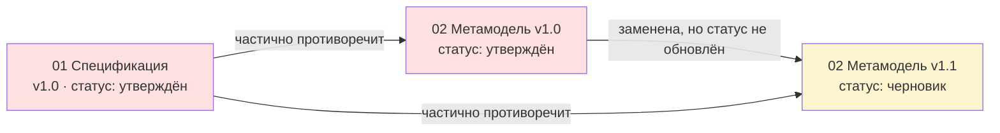
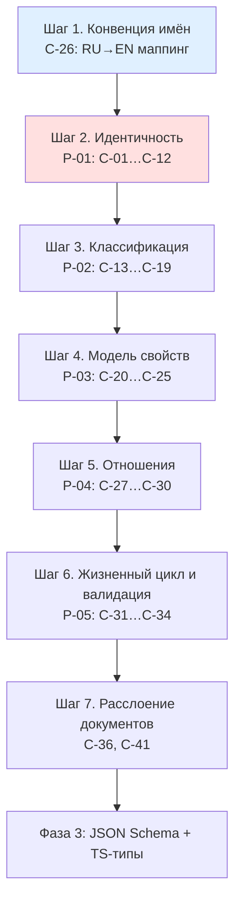
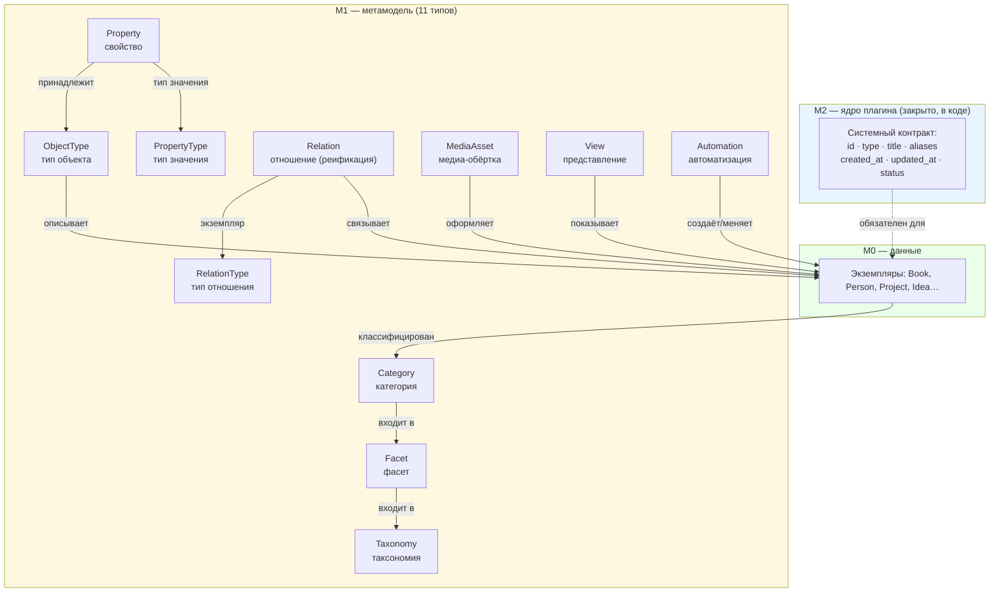

# Диагностика черновиков метамодели «Second Brain»

> **Статус документа:** `draft` (диагноз сохранён как исторический документ, не переписывается).
> Часть 2 («Гипотеза целевого ядра») — **предложение ассистента**, требует подтверждения пользователем.
> Ничто из этого документа не меняет черновики в `inbox/` (они read-only).

> ## ⚑ СТАТУС ПОЗИЦИЙ НА 2026-10-21 (метамодель v0.11.0) — ЗАКРЫТЫ ВСЕ 41
>
> **Закрыты: 41 из 41.** C-01…C-41.
>
> | Группа | Позиции | Чем закрыты |
> |---|---|---|
> | Идентичность и именование | C-01…C-12 | ADR-0001, ADR-0002, ADR-0004 |
> | Классификация | C-13…C-19 | ADR-0005, ADR-0007 |
> | Свойства и привязка к типам | C-20…C-26 | ADR-0003, ADR-0001 |
> | Отношения | C-27…C-30 | ADR-0006 |
> | Жизненный цикл и целостность | C-31…C-34 | ADR-0009, `validation/RULES.md` |
> | Слой реализации и документация | C-35…C-41 | X-01, `plugin/ARCHITECTURE.md`, `metamodel/05_document_status_register.md` |
>
> **Последние шесть закрыты шагом 7 фазы 2:**
> C-04, C-05 — недействительные ID черновиков: класс ошибки устранён структурно (ULID не требует
> счётчика, `contract.r3` и `naming.r4…r6` обнаруживают нарушения);
> C-36 — расслоение документов: `docs/plugin/ARCHITECTURE.md` с правилом L-1…L-4;
> C-37 — служебные документы не являются объектами метамодели (X-05);
> C-38 — авторитетные статусы черновиков зафиксированы в реестре, приоритет у ADR;
> C-41 — версии документа (`version`) и метамодели (`metamodel_version`) разделены нормативно.
>
> **Дополнительно закрыты:** 15 пробелов сценариев (G-1…G-15), 14 требований пользователя (T1…T14),
> 5 требований, зарегистрированных как R-TRIGGER, R-ORGTYPE и др.
>
> Текст ниже сохранён **без изменений** как снимок состояния на момент диагностики.

---

# ЧАСТЬ 1. ФАКТЫ: что прислано и что в нём есть

## 1.1. Инвентаризация файлов

| # | Файл | Объём | Строк | Внутренние метаданные | Что это |
|---|---|---|---|---|---|
| 1 | `inbox/01_Second_Brain_Architecture_Specification.md` | 11 810 Б | 648 | `id: DOC-000001`, `версия: 1.0`, `статус: утверждён` | **Архитектурная спецификация**: 19 разделов — основная модель, ядро объекта, ID, имена файлов, типы объектов, свойства, категории, таксономии, отношения, представления, изображения, автоматизация, наследование, жизненные циклы, миграции, архивирование, контроль целостности |
| 2 | `inbox/02_Метамодель_v1.0.md` | 5 657 Б | 264 | `id: DOC-000002`, `версия: 1.0`, `статус: утверждён` | **Метамодель v1.0**: 10 разделов — по одному YAML-примеру на каждый из 8 системных типов + главная архитектурная цепочка |
| 3 | `inbox/02_Метамодель_v1.1_черновик.md` | 91 793 Б | 933 | `id: DOC-000002`, `версия: 1.1-draft`, `статус: черновик` | **Метамодель v1.1 (черновик)**: 18 разделов. Добавлены: ULID, `TYPE_PREFIX`, канонические ссылки, слой «Фасет», обёртка изображения, создание объектов из пустых ссылок, системные атрибуты, служебная область `.sb/`, отображаемые названия (TitleResolver), валидация и SchemaEngine. Плюс 28 незакрытых решений |

**Итого:** ~109 КБ текста, 1845 строк, 3 документа, 47 разделов.

### Отношения между документами (важно)

**Ключевой факт:** документ с более ранними решениями (`01 Спецификация`) помечен `статус: утверждён`,
а документ с более поздними решениями (`v1.1`) — `статус: черновик`. Формально **утверждённая спецификация
противоречит черновой метамодели**, и неясно, какой из документов имеет приоритет. Это надо закрыть первым.

## 1.2. Что в метамодели уже хорошо (не трогать)

Это сильные решения, которые я рекомендую сохранить без изменений:

| # | Сильное решение | Где | Почему это хорошо |
|---|---|---|---|
| S1 | **Метамодель как данные** (типы, свойства, отношения — сами объекты в хранилище) | весь документ | Добавление нового типа/свойства не требует перекомпиляции плагина. Это правильный выбор для личной БЗ, которая будет расти |
| S2 | **Разделение «тип отношения» / «отношение»** | spec §9–10, v1.0 §4–5 | Семантика отделена от экземпляра связи — это уровень настоящей онтологии, а не набора заметок |
| S3 | **Разделение «тип свойства» / «свойство» / «значение свойства»** | spec §6, v1.0 §2–3 | Чёткая трёхуровневая модель: `Текст` → `Издательство` → `"АСТ"` |
| S4 | **Наследование типов с правилами** (можно сужать, нельзя менять смысл и ослаблять обязательность) | spec §14 | Правила сформулированы корректно и реализуемо |
| S5 | **ID: уникален, стабилен, неизменяем, не переиспользуется** | spec §3, v1.1 §1.1 | Фундамент всей модели. Требование «не зависит от названия» — верное |
| S6 | **Архивирование предпочтительнее удаления** | spec §18 | Правильная политика для БЗ |
| S7 | **«Система не должна молча переписывать неправильные данные»** | spec §19, v1.1 §15.5, §18.5 | Отличный принцип; я предлагаю сделать его первым правилом валидации плагина |
| S8 | **Разделение «фильтрация кандидатов» и «валидация значения»** | v1.1 §18.2 | Зрелое решение: UI-фильтр ≠ гарантия целостности |
| S9 | **Bases и Fileclass — необязательные интеграции, не источник истины** | v1.1 §18.1, §18.6, §18.7 | Правильная защита метамодели от зависимости от чужих плагинов |
| S10 | **Разделение метамодели и реализации** повторяется системно | v1.1 §10.5, §11.5, §14.3 | Верный принцип, но, как покажет C-27, он нарушен в том же документе |

**Вывод:** модель концептуально сильная. Проблемы не в архитектуре, а в (а) несогласованности трёх документов,
(б) незакрытых связках между сущностями, (в) перегрузке черновика реализацией.

## 1.3. Инвентарь сущностей

### A. Системные типы (L1 — метамодель описывает саму себя)

| Сущность | Что есть | Что неясно | Предлагаемое решение |
|---|---|---|---|
| **Тип объекта** (`ObjectType`) | `id`, `название`, `тип_объекта`, `родительский_тип`, `описание`. Правило: хранится только непосредственный родитель | **Нет поля со списком свойств типа.** Нет поля `TYPE_PREFIX`. Нет признака «абстрактный/конкретный». Нет признака «системный/предметный» | Добавить `properties` (или механизм привязки — см. P-03), `type_prefix`, `is_abstract`, `layer` |
| **Тип свойства** (`PropertyType`) | 8 объектов, набор закрыт: Текст, Число, Дата, Дата и время, Логическое, Список, Список ссылок | `Список` и `Список ссылок` дублируют `кардинальность`. Нет способа сказать «список **чего**» | Убрать списочные типы; ввести `is_multiple` + `item_type` (см. C-15) |
| **Свойство** (`Property`) | `id`, `название`, `тип_объекта`, `тип_значения`, `кардинальность`, `обязательность`, `определение`, `область_применения`, `уровень`, `жизненный_цикл` | `область_применения` и `уровень` дублируют друг друга. Нет ограничения допустимых значений. Неясно пространство значений `тип_значения` | Объединить дубли; добавить `allowed_values`; разделить пространства значений `тип_значения` и `тип_отношения` (C-17) |
| **Тип отношения** (`RelationType`) | `id`, `название`, `тип_объекта`, `прямое_название`, `обратное_название`, `направление`, `рекомендуемый_субъект`, `рекомендуемый_объект`, `кардинальность`, `правило_уникальности` | `направление` — нет enum. `правило_уникальности` — нет enum и нет семантики. «Рекомендация ≠ запрет» — но нет флага «строгое/рекомендательное» | Ввести enum `direction`; enum `uniqueness_rule`; флаг `is_restriction` (soft/hard) |
| **Отношение** (`Relation`) | Реифицированная связь: `субъект`, `тип_отношения`, `объект` + локальные `порядок`, `основное`, `дата_начала`, `дата_окончания`, `источник`, `контекст`, `описание` | **Гибридная модель**: та же связь может жить и в свойстве, и в объекте. Правила синхронизации нет (признаёт сам документ) | Ввести явное правило: когда ссылка, когда объект; как избежать дубля (P-05) |
| **Таксономия** (`Taxonomy`) | v1.0: `режим_иерархии`, `кардинальность_назначения`, `допустимые_типы_объектов`, `требование_корня`. v1.1: `фасеты`, `допустимые_типы_объектов` | Настройки переехали на Фасет, но в v1.0 остались на Таксономии. Не решено, наследует ли Фасет значения от Таксономии | Зафиксировать: настройки — на Фасете, Таксономия — только область применения и состав фасетов |
| **Фасет** (`Facet`) | Появился **только в v1.1**: `таксономия`, `режим_иерархии`, `кардинальность_назначения`, `требование_корня` | Отсутствует в spec и v1.0. Взаимные ссылки Таксономия↔Фасет (риск рассинхрона). Категория в v1.0 ссылается на Таксономию, в v1.1 — на Фасет | Утвердить 4-уровневую цепочку; хранить ссылку только «вверх» (C-10, C-11) |
| **Категория** (`Category`) | `таксономия` (v1.0) / `фасет` (v1.1), `родитель`. Корень = пустой `родитель` | `родитель` — список, но семантика «полиaрхическая» допускает несколько родителей, а «строгая» — одного. Кардинальность не выражена | Явная кардинальность `родитель`: 0..1 для строгой, 0..N для полиархической |
| **Представление** (`View`) | `описание`, `целевые_типы_объектов`, `механизм: Base`, `активное` | `механизм` — нет enum; `Base` — это конкретная фича Obsidian, т.е. реализация просочилась в модель. Нет полей запроса/сортировки/колонок | Enum `mechanism`; вынести детали Bases в реализацию; добавить `definition` |
| **Автоматизация** (`Automation`) | `описание`, `триггер: ручной`, `механизм: QuickAdd`, `целевые_типы_объектов`, `активное` | `QuickAdd` — сторонний плагин, при этом spec §13 говорит «код не является частью метамодели». `триггер` — нет enum | То же: enum + абстракция от конкретных инструментов |
| **Обёртка изображения** (`ImageWrapper`) | Семантические роли (7 шт.), может использоваться несколькими объектами, механизм контекстного разрешения | **Нет поля со ссылкой на сам файл изображения.** Роли не формализованы (enum? фасет? категории?). Критерии выбора обёртки не определены | Добавить `file`; роли → enum справочника (не фасет) |
| **Документация** (`Documentation`) | Используется в frontmatter всех трёх файлов (`тип_объекта: документация`) | **Тип не определён ни в одном документе.** Отсутствует в списке типов spec §5 | Либо определить тип `Document`, либо вывести служебные документы из-под метамодели |

### B. Предметные типы (L0 — то, что описывает знания пользователя)

Из spec §5, 8 групп + 43 типа:

| Группа | Типы | Замечания |
|---|---|---|
| Системные | Категория, Таксономия, Свойство, Тип свойства, Отношение, Тип отношения, Представление, Автоматизация | Смешаны с L1. Плюс в v1.1 добавился Фасет — в этот список не внесён |
| Знание | Знание, Концепция, Идея, Гипотеза, Вывод, Решение | Пересечение с `Решение` в нашей документации; `Знание` как тип неопределённо |
| Произведение | Книга, Веб-новела, Глава, Стихотворение, Текст песни, Фильм, Сериал, Эпизод, Музыкальный трек, Музыкальный альбом, Видеоигра | Сказано, что это «концептуальный родительский уровень, а не обязательно создаваемая заметка» — но при этом используется как цель ссылки `[[Произведение — OBJECT-TYPE-000003]]` |
| Коллекция | Франшиза, Книжная серия, Серия фильмов, Музыкальная серия, Галерея | Тоже «концептуальный уровень» |
| Источник | Статья, Веб-страница, Видео, Аудио | `Видео` и `Аудио` пересекаются с `Фильм`/`Музыкальный трек` по смыслу |
| Контекст | Человек, Организация, Место, Событие | Ядро любой БЗ |
| Деятельность | Проект, Задача, Цель, Проблема | Ядро |
| Медиаматериал | Обёртка изображения | Группа из одного элемента |
| *(вне списка)* | **Персонаж** (`CHARACTЕR`) | Объявлен «самостоятельным типом», но **отсутствует в классификации**. В префиксе — кириллическая «Е» (см. C-06) |

### C. Механизмы, описанные в черновиках (не сущности, а поведение)

| Механизм | Где | Природа |
|---|---|---|
| Каноническая ссылка и её нормализация | v1.1 §1.4 | Реализация плагина |
| Синхронизация `aliases[0]` с `название` | v1.1 §1.4 | Реализация + системный контракт |
| Создание объекта из пустой ссылки | v1.1 §11 | Реализация плагина |
| Контекстное разрешение изображений | v1.1 §10 | Реализация плагина |
| `TitleResolver` / `TitleIndex` / `TitleDisplayAdapter` | v1.1 §17 | Реализация плагина (13 точек интеграции UI) |
| `SchemaEngine` | v1.1 §18.3 | Реализация плагина |
| `BasesAdapter` | v1.1 §18.6 | Реализация плагина |
| Служебная область `.sb/`, миграции, бэкапы, логи | v1.1 §15 | Реализация плагина |
| Жизненный цикл данных / модельных сущностей | spec §15–16 | **Модель** (но не имеет поля хранения) |
| Контроль целостности (6 видов проверок) | spec §19 | **Модель правил** (но не формализован) |

## 1.4. Инвентарь связей, которые уже заявлены

| Связь | Откуда | Куда | Кардинальность (как заявлена) | Проблема |
|---|---|---|---|---|
| `родительский_тип` | ObjectType | ObjectType | список, «только непосредственный родитель» | Список при семантике «один родитель» |
| `тип_объекта` | любой объект | ObjectType | 1 | Хранится строкой или ссылкой — не определено (C-09) |
| `тип_значения` | Property | PropertyType | 1 | Пространство значений пересекается с `тип_отношения` (C-17) |
| `тип_отношения` | Relation | RelationType | 1 | — |
| `субъект` / `объект` | Relation | любой объект | 1 / 1 | Нет ограничения на допустимые типы |
| `рекомендуемый_субъект` / `рекомендуемый_объект` | RelationType | ObjectType | список | «Рекомендация ≠ запрет» — мягкое ограничение без флага |
| `фасеты` | Taxonomy | Facet | список | Дублируется обратной ссылкой `таксономия` у Фасета |
| `таксономия` | Facet | Taxonomy | 1 | — |
| `фасет` | Category | Facet | 1 | В v1.0 вместо этого `таксономия` |
| `родитель` | Category | Category | список | Кардинальность зависит от `режим_иерархии`, но не выражена |
| `категории` | любой объект | Category | список | Формат хранения назначений «будет уточнён» (пробел №12 в списке) |
| `целевые_типы_объектов` | View, Automation | ObjectType | список | — |
| **(отсутствует)** | ObjectType | Property | — | **Главный пробел: привязки свойств к типу нет** |
| **(отсутствует)** | любой объект | LifecycleState | — | Жизненный цикл объявлен, поля нет |
| **(отсутствует)** | ImageWrapper | файл изображения | — | Поля нет |

---

## 1.5. Реестр противоречий, дублей и пробелов

Обозначения: **C** = противоречие (contradiction), **D** = дубль, **G** = пробел (gap).
Критичность: 🔴 блокирует ядро · 🟠 влияет на схему · 🟡 влияет на реализацию.

### Группа 1. Идентичность и именование

| ID | Крит. | Тип | Формулировка | Где |
|---|---|---|---|---|
| **C-01** | 🔴 | C | **Формат ID.** Spec §3: `КОДТИПА-000001`, примеры `PERSON-000001`, «возможен ULID или UUID v7». v1.1 §1.1: «Основной и единственный формат — ULID. UUID v7 не используется». Оба документа действующие | spec §3 ↔ v1.1 §1.1 |
| **C-02** | 🔴 | C | **Имя файла.** Spec §4: `Название — ID.md` (название входит в имя файла, разделитель — длинное тире с пробелами). v1.1 §1.3: `{TYPE_PREFIX}-{ID}.md` (название НЕ входит, разделитель — дефис). Это взаимоисключающие решения | spec §4 ↔ v1.1 §1.3 |
| **C-03** | 🔴 | C | **Формат ссылки.** Spec: `[[Михаил Булгаков — PERSON-000001]]` (цель = полное имя файла). v1.1: `[[PERSON-<ULID>.md\|Михаил Булгаков]]` (цель + alias). Разные механизмы разрешения ссылок | spec §9 ↔ v1.1 §1.4 |
| **C-04** | 🟠 | C | **Два ID у одного документа.** `DOC-000002` присвоен и `Метамодель v1.0`, и `Метамодель v1.1`. Прямое нарушение требования «ID уникален» (spec §3) | v1.0 frontmatter ↔ v1.1 frontmatter |
| **C-05** | 🔴 | C | **Один ID — разные объекты.** `OBJECT-TYPE-000001` = «Книга» (v1.0 §6) и «Человек» (v1.0 §1). `OBJECT-TYPE-000003` = «Фильм» (spec §11), «Произведение» (v1.0 §4), «Веб-новела» (v1.0 §6). `OBJECT-TYPE-000006` = «Контекст» (v1.0 §1) и «Человек» (v1.0 §4). `OBJECT-TYPE-000000` (spec §13) — вне формата `000001` | spec §11,13 ↔ v1.0 §1,4,6 |
| **C-06** | 🟠 | C | **Омоглиф в TYPE_PREFIX.** Spec §5: `CHARACTЕR` — буква «Е» кириллическая (U+0415), проверено побайтово. Технический префикс обязан быть ASCII | spec §5 |
| **C-07** | 🟠 | G | **Реестр TYPE_PREFIX не утверждён, но уже используется.** В примерах встречаются `BOOK`, `WEBNOVEL`, `CHAPTER`, `PROJECT`, `VIEW`, `AUTOMATION`, `DOC`, `FACET`, `PROPERTY-TYPE`, `RELATION-TYPE`, `OBJECT-TYPE`. Реестра нет (это же — открытый вопрос №1 в v1.1 §13) | spec §3, v1.1 §1.2 |
| **C-08** | 🟠 | C | **Коллизия префиксов.** `PROPERTY-000001` (свойство) и `PROPERTY-TYPE-000001` (тип свойства) — разные сущности, но второй префикс начинается с первого. Требование «префикс уникален» не определяет, как сравнивать: по точному совпадению или по префикс-началу | spec §3 |
| **C-09** | 🟠 | G | **`тип_объекта`: строка или ссылка?** Во всех примерах — строка (`тип_объекта: свойство`), но `родительский_тип` — wikilink. Если строка, то значение не связано с объектом `ObjectType` и не проверяется | v1.0 §1–9, v1.1 §2–9 |
| **C-10** | 🟠 | C | **Смена типа объекта.** Spec §17: при изменении типа создаётся новый объект с новым ID, старый архивируется. v1.1 §1.5: «Изменение типа не должно автоматически менять его ID». Противоположные правила | spec §17 ↔ v1.1 §1.5 |
| **C-11** | 🟠 | D | **Дублирование `название` в `aliases[0]`.** Сознательное решение (v1.1 §1.4), но: (а) Obsidian использует `aliases` для разрешения ссылок → объект станет доступен по имени файла и по названию одновременно; (б) два источника одного значения требуют постоянной синхронизации | v1.1 §1.4 |
| **C-12** | 🟡 | G | **Смена типа vs смена имени файла.** Если `TYPE_PREFIX` входит в имя файла, смена типа обязана переименовать файл → все ссылки. Правило не определено (открытый вопрос №2 в v1.1 §13) | v1.1 §1.5 |

### Группа 2. Классификация

| ID | Крит. | Тип | Формулировка | Где |
|---|---|---|---|---|
| **C-13** | 🔴 | C | **3 уровня против 4.** Spec §7 и v1.0 §7: `Таксономия → Категория → Объект`. v1.1 §7: `Таксономия → Фасет → Категория → Назначение`. Фасета нет в утверждённой спецификации | spec §7 ↔ v1.1 §7 |
| **C-14** | 🟠 | C | **Где живут настройки.** Spec §8: `режим_иерархии`, `кардинальность_назначения`, `требование_корня` — у Таксономии. v1.1 §7.2: те же поля — у Фасета. Наследование значений не определено (открытый вопрос №6) | spec §8 ↔ v1.1 §7.1–7.2 |
| **C-15** | 🟠 | D | **Взаимные ссылки Таксономия↔Фасет.** У Таксономии `фасеты: [...]`, у Фасета `таксономия: ...`. Два хранения одного факта → рассинхрон | v1.1 §7.1–7.2 |
| **C-16** | 🟠 | G | **Персонаж не классифицирован.** Объявлен «самостоятельным типом», но отсутствует в списке групп spec §5. Неясно, наследуется ли от `Контекст` и как связан с `Произведение` | spec §5 |
| **C-17** | 🟠 | C | **Абстрактный тип используется как конкретный.** Spec §5: «Произведение и Коллекция — концептуальные родительские уровни, а не обязательно создаваемые заметки». Но v1.0 §4: `рекомендуемый_субъект: [[Произведение — OBJECT-TYPE-000003]]`. Нет признака «абстрактный тип» | spec §5 ↔ v1.0 §4 |
| **C-18** | 🟡 | C | **Пересечение групп.** `Видео` (Источник) и `Фильм`/`Сериал`/`Эпизод` (Произведение); `Аудио` (Источник) и `Музыкальный трек` (Произведение). Критерий различения не сформулирован | spec §5 |
| **C-19** | 🟡 | G | **Группы spec §5 — это не сущности метамодели.** «Знание», «Произведение», «Контекст» и т.д. нигде не описаны как объекты. Это ветки наследования? категории? фасет? Просто заголовки? Не определено | spec §5 |

### Группа 3. Свойства и привязка к типам

| ID | Крит. | Тип | Формулировка | Где |
|---|---|---|---|---|
| **C-20** | 🔴 | G | **Нет механизма привязки Свойства к Типу объекта.** Ни у `ObjectType` нет списка свойств, ни у `Property` нет списка применимых типов. При этом spec §14 описывает наследование свойств («дочерний тип может уточнять обязательность, сужать кардинальность») — наследовать нечего, связь не определена. **Без этого модель не может описать ни один объект** | v1.0 §1,3; v1.1 §2,4; spec §14 |
| **C-21** | 🟠 | D | **`область_применения` и `уровень` дублируют друг друга.** В примере оба = `универсальное`. Spec §14 задаёт три уровня: универсальные / семейства / специализированные. Два поля для одного понятия | v1.0 §3, v1.1 §4 |
| **C-22** | 🟠 | D | **`Список` / `Список ссылок` vs `кардинальность`.** Множественность выражена дважды: типом значения и кардинальностью. Плюс нет способа выразить «список чисел» или «список дат» | spec §6, v1.0 §2–3 |
| **C-23** | 🟠 | C | **Формат кардинальности несогласован.** У Таксономии/Фасета: `0..1`, `1`, `0..N`, `1..N`. У Свойства: `1`. У Типа отношения: `0..N`. В JSON-примере v1.1 §15.3 — отдельное булево `multiple`. Четыре способа выразить одно | v1.0 §3,4,6; v1.1 §15.3 |
| **C-24** | 🟠 | G | **Нет ограничений допустимых значений.** Spec §19 требует семантических проверок, но у Свойства нет ни enum, ни диапазона, ни формата, ни регулярного выражения. Валидировать нечем | v1.0 §3, v1.1 §4 |
| **C-25** | 🟠 | G | **`название` определено дважды.** Как системный атрибут (v1.1 §14.2) и как объект `Property` с `id: PROPERTY-000001` (v1.0 §3). Документ сам это замечает («не должно дублироваться без явно установленной связи»), но связь не определена | v1.0 §3 ↔ v1.1 §14.2 |
| **C-26** | 🟡 | C | **Русские и английские имена вперемешку.** Markdown-примеры: `название`, `тип_значения`. JSON-пример: `key`, `valueType`, `targetTypes`, `required`, `multiple`. Плюс v1.1 §14.2: «решение о переименовании `тип_объекта` в `type` не принято» | v1.1 §14.2, §15.3 |

### Группа 4. Отношения

| ID | Крит. | Тип | Формулировка | Где |
|---|---|---|---|---|
| **C-27** | 🔴 | C/D | **Гибридное представление связи = риск дубля.** Одна и та же связь может храниться как ссылка в свойстве объекта И как отдельный объект `Отношение`. Документ прямо признаёт: «Правило преобразования… требует отдельной спецификации. Нельзя допускать неявного дублирования одной связи» — но правила нет | v1.1 §6 |
| **C-28** | 🟠 | G | **`правило_уникальности` не определено.** Значение `уникальная_связь` — уникальность чего? Тройки (субъект, тип, объект)? Пары (субъект, объект)? Других значений enum нет | v1.0 §4, v1.1 §5 |
| **C-29** | 🟠 | G | **`направление` не имеет enum.** Показано только `направленное`. Есть ли `ненаправленное`/`симметричное`? Как направление связано с `прямое_название`/`обратное_название`? | v1.0 §4, v1.1 §5 |
| **C-30** | 🟡 | G | **Локальные свойства Отношения не специфицированы.** `порядок`, `основное`, `дата_начала`, `дата_окончания`, `источник`, `контекст`, `описание` перечислены без типов, обязательности и правил | v1.0 §5, v1.1 §6 |

### Группа 5. Жизненный цикл и целостность

| ID | Крит. | Тип | Формулировка | Где |
|---|---|---|---|---|
| **C-31** | 🔴 | G | **Жизненный цикл объявлен, но хранить его негде.** Spec §15: 6 состояний данных. Spec §16: 4 состояния модельных сущностей. `жизненный_цикл` есть только у `Property`. У обычных объектов поля статуса нет. Архивирование (spec §18) физически нереализуемо в модели | spec §15–16, §18 |
| **C-32** | 🟠 | G | **Нет связей для миграции и слияния.** Spec §17: «связь между объектами фиксируется» — тип отношения не определён. Spec §18: «история сохраняется» — как именно, не определено | spec §17–18 |
| **C-33** | 🟠 | G | **Контроль целостности не формализован.** Spec §19 называет 6 видов проверок, но ни одного правила. Нет ни уровней (error/warn), ни сообщений, ни привязки к полям | spec §19 |
| **C-34** | 🟡 | G | **Даты: нет формата и часового пояса.** `дата` и `дата_время` объявлены типами, но ISO 8601 / offset / локальное время не оговорены. Интервалы (`дата_начала`/`дата_окончания`) — включительность границ не определена | spec §6, v1.1 §6 |

### Группа 6. Слой реализации и документация

| ID | Крит. | Тип | Формулировка | Где |
|---|---|---|---|---|
| **C-35** | 🔴 | C | **Два источника истины для метамодели.** v1.0/v1.1: определения метамодели — Markdown-заметки с YAML frontmatter (`тип_объекта: свойство`). v1.1 §15: определения — JSON в скрытой папке `.sb/metamodel/`. Оба варианта описаны как основные, приоритет не установлен | v1.0 §1–9 ↔ v1.1 §15 |
| **C-36** | 🟠 | C | **Нарушен собственный принцип «код не часть метамодели».** Spec §13. При этом `механизм: QuickAdd` и `механизм: Base` — конкретные инструменты — зашиты как значения поля модели. Разделы 10, 11, 15, 17, 18 v1.1 (~60 % объёма) — описание реализации плагина внутри документа метамодели | spec §13 ↔ v1.1 §8,9,10,11,15,17,18 |
| **C-37** | 🟠 | G | **Тип `документация` не определён**, но использован в frontmatter всех трёх файлов. Служебные документы либо объекты метамодели (тогда нужен тип), либо нет (тогда не должны иметь `id` в её формате) | все три файла |
| **C-38** | 🟠 | C | **Статусы документов не соответствуют действительности.** v1.0 `статус: утверждён`, хотя заменён v1.1. Spec `статус: утверждён`, хотя противоречит v1.1 по 12 позициям. Нет поля `superseded_by` | frontmatter всех файлов |
| **C-39** | 🟡 | G | **`ImageWrapper` не имеет поля ссылки на файл изображения** | v1.1 §10 |
| **C-40** | 🟡 | G | **Роли изображений не формализованы.** 7 ролей перечислены прозой + «другие роли». Не enum, не фасет, не справочник | spec §12, v1.1 §10.1 |
| **C-41** | 🟡 | C | **Версии документа и версии метамодели смешаны.** `версия: 1.1-draft` — это версия документа или модели? Наш проект требует semver для метамодели | frontmatter |

**Итого: 41 позиция** — 22 противоречия, 7 дублей, 12 пробелов. Из них 🔴 критичных — 8.

---

## 1.6. Пять главных проблем и порядок решения

| № | Проблема | Состоит из | Почему именно так | Что будет, если не решить |
|---|---|---|---|---|
| **P-01** | **Идентичность и именование** — как называется объект, как формируется имя файла, как выглядит ссылка | C-01…C-12 | Это фундамент: от него зависят имена всех полей, формат всех ссылок, работа переименований и **целый раздел 17 v1.1 (~90 строк про подмену отображения)**. Меняется последним с наибольшей болью | Модель нельзя ни реализовать, ни мигрировать; каждая ссылка в базе потенциально бита |
| **P-02** | **Классификация** — сколько уровней, где настройки, что такое группы из spec §5, абстрактные vs конкретные типы | C-13…C-19 | Это и есть «классификация» из твоего запроса. Определяет состав ядра | Дубли категорий, невозможность валидировать назначения |
| **P-03** | **Модель свойств** — как свойство привязывается к типу, как работает наследование, как выражаются множественность и ограничения | C-20…C-26 | Без привязки свойство «висит в воздухе»: модель неспособна описать ни один объект. Это самый большой структурный пробел | Плагин не сможет построить форму и валидатор — ядро MVP невозможно |
| **P-04** | **Отношения** — одна форма представления или две, уникальность, направление | C-27…C-30 | Определяет, как строится граф и как избежать дублей связей | Дубли связей, расхождение графа и данных |
| **P-05** | **Жизненный цикл и валидация** — где хранится статус, как формализуются правила | C-31…C-34 | Без этого архивирование, миграции и контроль целостности остаются декларацией | Невозможно выполнить требование «не молча переписывать данные» |

**Отдельно, вне пяти главных:**
- **C-35 (два источника истины)** — решается на стыке фаз 3–4, когда перейдём к плагину. **Предложение по умолчанию уже сформулировано** (см. §2.6) — оно снимает противоречие без потери черновиков.
- **C-36, C-41 (расслоение документа)** — решается организационно: метамодель отдельно, архитектура плагина отдельно. Предлагаю сделать это сразу после фазы 2.
- **C-26 (язык имён)** — решено тобой (Q-03 = B): переименования допустимы с таблицей маппинга. Маппинг начнём в фазе 2.

### Предлагаемый порядок работы (фаза 2)

**Почему шаг 1 — конвенция имён.** Ты выбрал политику B (переименования допустимы). Значит, прежде чем
двигать сущности, надо зафиксировать, **как** они будут называться, иначе каждое последующее решение придётся
переименовывать заново. Шаг дешёвый (одно сообщение), закрывает C-26 и даёт основу для таблицы маппинга.

---

# ЧАСТЬ 2. ГИПОТЕЗА ЦЕЛЕВОГО ЯДРА

> **Статус части 2: `draft`, предложение ассистента.** Ниже — не утверждённая модель, а гипотеза,
> собранная из сильных решений твоих черновиков (S1–S10) и закрывающая критичные пробелы.
> Каждая позиция требует твоего подтверждения. Помечено: ✅ = беру из черновиков как есть,
> 🔧 = дорабатываю, ➕ = добавляю (в черновиках отсутствует).

## 2.1. Термины, которые надо ввести (объяснение для новичка)

| Термин | Простыми словами | Зачем нам |
|---|---|---|
| **Уровень метамодели (M0/M1/M2)** | M0 — сами заметки («Мастер и Маргарита»). M1 — типы этих заметок (`Book`, `Person`). M2 — правила, по которым устроены типы («у типа есть список свойств»). | В твоих черновиках все три уровня смешаны в одном списке типов. Разделение снимает C-19 и половину путаницы |
| **Реификация** | Превращение связи в самостоятельный объект, чтобы у связи появились свои свойства. «Авторство» — не просто стрелка, а объект с датой и источником | Это твоё `Отношение` — решение правильное, но нужна граница применения (C-27) |
| **Кардинальность** | Сколько значений допустимо: `0..1` (может не быть), `1` (ровно одно), `0..N` (сколько угодно), `1..N` (хотя бы одно) | Нужен один единый формат вместо четырёх (C-23) |
| **Фасет** | Отдельное измерение классификации. У книги есть жанр, тональность, место действия — это три фасета, а не три ветки одной иерархии | Твоё нововведение v1.1. Считаю его правильным, но надо закончить перенос (C-13…C-15) |
| **Абстрактный тип** | Тип, от которого наследуют, но экземпляры которого не создают. «Произведение» — абстрактный, «Книга» — конкретный | Снимает C-17 |
| **Системный контракт** | Поля, которые есть у каждого объекта всегда и заданы кодом, а не метамоделью: `id`, `type`, `title`, `aliases`, `created_at`, `updated_at`, `status` | Снимает C-25: `title` не надо описывать как обычное свойство |

## 2.2. Три уровня модели (➕ в черновиках не разделены)

| Уровень | Что здесь | Примеры | Где живёт |
|---|---|---|---|
| **M2 — ядро плагина** | Правила, по которым устроена метамодель. Закрытый набор, меняется только с релизом плагина | «У типа есть список свойств», «кардинальность выражается как min/max», «ID — ULID» | Код плагина + JSON Schema в репозитории |
| **M1 — метамодель пользователя** | Определения типов, свойств, отношений, фасетов. Расширяется без перекомпиляции | `ObjectType: Book`, `Property: publisher`, `RelationType: author` | Заметки vault (и/или `.sb/`) |
| **M0 — данные** | Экземпляры | `Мастер и Маргарита`, `Михаил Булгаков` | Заметки vault |

**Рекомендация:** M2 заморозить и не делать редактируемым в MVP. Это спасает от бесконечного усложнения.

## 2.3. Предлагаемое ядро M1: 11 типов вместо 12 разнородных

| № | Тип M1 | Префикс | Статус в гипотезе | Комментарий |
|---|---|---|---|---|
| 1 | `ObjectType` | `OTYPE` | ✅ из черновиков 🔧 | Добавить `properties`, `type_prefix`, `is_abstract` |
| 2 | `PropertyType` | `PTYPE` | ✅ 🔧 | 8 → **5** типов: `text`, `number`, `date`, `datetime`, `boolean`, `reference`. Списочность — через кардинальность (закрывает C-22) |
| 3 | `Property` | `PROP` | ✅ 🔧 | Убрать `область_применения` (дубль `уровень`); добавить `allowed_values` |
| 4 | `RelationType` | `RTYPE` | ✅ 🔧 | Добавить enum `direction`, enum `uniqueness_rule`, флаг `is_restriction` |
| 5 | `Relation` | `REL` | ✅ 🔧 | Оставить **только** для связей с атрибутами (закрывает C-27) |
| 6 | `Taxonomy` | `TAX` | ✅ 🔧 | Только `applicable_types` + состав фасетов (вычисляемый) |
| 7 | `Facet` | `FACET` | ➕ из v1.1 | Утвердить; настройки иерархии живут здесь |
| 8 | `Category` | `CAT` | ✅ 🔧 | Ссылка только на `facet` (не на таксономию) |
| 9 | `MediaAsset` | `MEDIA` | ✅ 🔧 | Переименовано с «Обёртка изображения» → обобщение до любого медиа. Добавить `file`, `role` (enum) |
| 10 | `View` | `VIEW` | ✅ 🔧 | `mechanism` → enum без привязки к брендам |
| 11 | `Automation` | `AUTO` | ✅ 🔧 | То же |

**Что убрано из ядра и почему:**

| Убрано | Куда | Обоснование |
|---|---|---|
| `Documentation` (C-37) | Служебные документы живут в репозитории `docs/`, вне метамодели | Документация проекта ≠ знание в базе. Не плодит сущности |
| Группы spec §5 (Знание, Произведение, Коллекция, Источник, Контекст, Деятельность) | **Абстрактные типы M1** (`Work`, `Source`, `Context`, `Activity`, `Knowledge`) с `is_abstract: true` | Они используются как родители наследования (C-17, C-19). Абстрактный тип — штатный механизм, а не «просто заголовок» |
| 43 предметных типа | **Не входят в ядро метамодели.** Это данные M1, которые наполняются после утверждения ядра | Ядро = 11 системных типов. Предметные типы — контент. Смешение — причина раздувания |

## 2.4. Предлагаемая классификация предметных типов (M1-контент)

**Гипотеза о твоём домене (предположение, которое можно изменить):** по составу типов (Веб-новела, Глава,
Персонаж, Франшиза, Текст песни, Эпизод) база ориентирована на **художественные произведения и их миры**
плюс обычный PKM-слой (люди, проекты, задачи, источники, идеи). Если это не так — скажи, классификацию пересоберу.

| Абстрактный тип | Конкретные типы (MVP-набор) | Отложено |
|---|---|---|
| `Context` | `Person`, `Organization`, `Place`, `Event`, `Character` | — |
| `Activity` | `Project`, `Task`, `Goal`, `Problem` | — |
| `Knowledge` | `Concept`, `Idea`, `Note` | `Hypothesis`, `Conclusion`, `Decision` |
| `Source` | `Article`, `WebPage`, `Video`, `Audio` | — |
| `Work` | `Book`, `Chapter`, `WebNovel`, `Film`, `Series`, `Episode`, `Track` | `Poem`, `Lyrics`, `Album`, `VideoGame` |
| `Collection` | `Franchise`, `BookSeries` | `FilmSeries`, `MusicSeries`, `Gallery` |

**Итого:** 6 абстрактных + 20 конкретных в MVP + 10 отложенных = 36 вместо 43 «плоских».

## 2.5. Три незакрытых связки — варианты и рекомендации

### Связка 1: как Свойство привязывается к Типу объекта (закрывает C-20, главный пробел)

| Вариант | Механизм | Плюсы | Минусы |
|---|---|---|---|
| **A. Список у типа** | `ObjectType.properties: [{property, required, cardinality, order}]` | Все ограничения типа в одном месте; легко переопределять при наследовании; одна заметка = полная форма | Переопределение требует вложенной структуры |
| **B. Список у свойства** | `Property.applies_to: [ObjectType…]` | Просто, плоско | Невозможно переопределить обязательность для конкретного типа; чтобы собрать форму, надо прочитать все свойства |
| **C. Объект-ассоциация** | Отдельный тип `PropertyAssignment` (связка тип↔свойство со своими атрибутами) | Максимальная гибкость, полностью в духе реификации | Взрыв числа объектов: 20 типов × 10 свойств = 200 заметок |

**Рекомендация: A + «универсальные свойства» как исключение.**
Универсальные свойства (`publisher`, `language` и т.п.) описываются один раз с `scope: universal`
и применяются ко всем типам автоматически; в `ObjectType.properties` попадают только специфичные и
переопределённые. Это сохраняет твою идею трёх уровней (spec §14) и не плодит объекты.

**Наследование при этом:** дочерний тип получает свойства родителя; в своём `properties` может
(a) повысить обязательность, (b) сузить кардинальность, (c) добавить ограничение, (d) добавить новое свойство.
Запрещено: менять смысл, менять тип значения, понижать обязательность — **ровно как у тебя в spec §14** (S4).

### Связка 2: одна связь или две формы (закрывает C-27)

| Вариант | Механизм | Плюсы | Минусы |
|---|---|---|---|
| **A. Только ссылки в свойствах** | `Отношение` как тип убирается | Просто, нет дублей | Теряем атрибуты связи (дата, источник, порядок) — а они у тебя уже спроектированы |
| **B. Только объекты `Отношение`** | Все связи — отдельные заметки | Полная выразительность | Каждое «автор» = отдельный файл. Для личной БЗ это сотни файлов-связок и тяжёлый UX |
| **C. Правило повышения (рекомендую)** | По умолчанию связь — ссылка в свойстве. Как только у связи появляется **хотя бы один атрибут** (дата, источник, порядок, контекст) — она обязана стать объектом `Отношение`, а ссылка в свойстве удаляется. Плагин контролирует: одна связь не может существовать в двух формах одновременно | Сохраняет лёгкость для 90 % связей и выразительность для 10 %; правило проверяемо | Нужна проверка «нет дубля» в валидаторе |

**Рекомендация: C.** Правило формулируется одной строкой и реализуется одной проверкой целостности.

### Связка 3: сколько уровней классификации (закрывает C-13…C-15)

| Вариант | Цепочка | Плюсы | Минусы |
|---|---|---|---|
| **A. 3 уровня (spec, v1.0)** | Taxonomy → Category → Object | Проще, уже «утверждён» | Невозможно выразить «жанр» и «тональность» как независимые измерения с разными правилами |
| **B. 4 уровня (v1.1)** | Taxonomy → Facet → Category → Object | Фасет несёт свои настройки иерархии и кардинальности; правильно онтологически | На один уровень больше объектов |
| **C. 2 уровня** | Facet → Category (таксономия убирается) | Минимум сущностей | Теряем группировку фасетов по областям применения |

**Рекомендация: B** (твоё же решение v1.1), но с двумя уточнениями:
1. Ссылка хранится **только вверх**: `Category.facet`, `Facet.taxonomy`. Состав фасетов у таксономии — **вычисляемый**, не хранится (закрывает C-15).
2. Настройки иерархии живут **только на фасете**. Таксономия может задавать значения по умолчанию,
   которые фасет наследует, если своё поле пустое (закрывает C-14 и открытый вопрос №6).

## 2.6. Гипотеза по C-35 (два источника истины) — предлагаемое решение по умолчанию

**Предположение, которое можно изменить** (ты не ответил на Q-04, а черновики его частично закрыли сами).

Черновики задают: экземпляры (M0) — Markdown с YAML frontmatter; определения метамодели (M1) — либо
тоже Markdown (v1.0), либо JSON в `.sb/` (v1.1 §15). Противоречие снимается так:

| Слой | Источник истины | Производное |
|---|---|---|
| M0 (данные) | **Markdown + YAML frontmatter** | индекс в памяти плагина |
| M1 (метамодель) | **Markdown + YAML frontmatter** (как в v1.0) | `.sb/cache/*.json` — кэш и compiled-схема, **пересобираемый, не редактируемый** |
| M2 (ядро) | **код плагина + JSON Schema в репозитории** | — |

**Обоснование:**
- Один источник истины → нет рассинхрона (главная болезнь C-35).
- Markdown-определения остаются видимыми в Obsidian, редактируемыми, версионируемыми в git, работают офлайн и без плагина.
- JSON в `.sb/` перестаёт быть вторым источником и становится **артефактом сборки** — его можно удалить и пересобрать.
- Требование v1.1 §15.4 («штатное редактирование через UI плагина») сохраняется: UI просто пишет в те же Markdown-файлы.
- Задел под RDF/OWL: Markdown-определения тривиально конвертируются в тройки, потому что каждое поле — пара «субъект-предикат-объект».

**Риск:** парсинг YAML-определений медленнее чтения JSON. Митигция — кэш в `.sb/cache/` с инвалидацией по событиям файлового API (механизм описан у тебя же в v1.1 §15.5).

---

## 2.7. Что я НЕ менял без твоего согласия

Перечисляю явно, чтобы ты видел границы гипотезы:

| Позиция черновиков | Моё отношение | Действие |
|---|---|---|
| Метамодель как данные (S1) | Полностью поддерживаю | Сохранено |
| ULID как формат ID | Поддерживаю, но это **изменение, требующее подтверждения**, потому что spec §3 «утверждён» с другим форматом | Вопрос Q2 |
| `{TYPE_PREFIX}-{ID}.md` как имя файла | **Не поддерживаю** — см. Q2, вариант C | Вопрос Q2 |
| Фасет как 4-й уровень | Поддерживаю | Вопрос Q4 (не задан в этот раз, см. Компас) |
| Раздел 17 (TitleResolver, 13 адаптеров UI) | Считаю преждевременным для MVP: существует **только** как следствие выбора имени файла без названия | Вопрос Q2, вариант C снимает ~70 % проблемы |
| Разделы 10, 11, 15, 18 (реализация) | Ценны, но это архитектура плагина, не метамодель | Предлагаю вынести в отдельный документ в фазе 3–4 |
| 28 открытых вопросов v1.1 §13 | Хороший список; 12 из них закрываются решениями P-01…P-05, остальные относятся к реализации | Перенесу в `PROJECT_MAP.md` §5 с привязкой к фазам |

---

## 2.8. История изменений

| Версия | Дата | Что изменилось | Решение |
|---|---|---|---|
| 0.2.0 | 2026-10-21 | Документ создан: инвентаризация 3 черновиков, 41 позиция противоречий/дублей/пробелов, 5 главных проблем, гипотеза целевого ядра | D-0006, D-0007, D-0008 |
