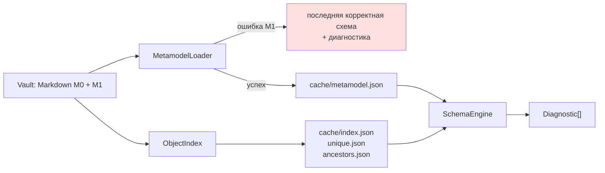

# Архитектура плагина Second Brain

> **Уровень документа:** реализация. Здесь **нет** положений метамодели — они в `docs/metamodel/`.
> Граница зафиксирована правилом L-1 (см. §1). Документ создан шагом 7 фазы 2 и закрывает C-36:
> в черновике v1.1 разделы 10, 11, 15, 17, 18 (~60 % объёма) описывали реализацию внутри документа метамодели.

---

## 1. Правило расслоения (нормативное)

| Правило | Содержание |
|---|---|
| **L-1** | **Нормативный справочный набор** описывает **только** семантику: типы, свойства, связи, ограничения, значения. Ни одного имени класса, метода, библиотеки или точки API. Состав набора — в §1.1 |
| **L-2** | Документы в `docs/plugin/` описывают **только** реализацию: модули, API, UX, этапы. Семантика в них не переопределяется, а только используется по ссылке |
| **L-3** | Если изменение реализации требует изменения семантики — это правка метамодели: ADR + запись в changelog + подтверждение пользователя (правило из ТЗ, фаза 5) |
| **L-4** | Значения полей `mechanism`, `trigger` и подобные — **абстрактные идентификаторы**, а не названия инструментов. `QuickAdd`, `Base`, `Dataview` в значениях enum запрещены (закрывает нарушение принципа spec §13 «код не является частью метамодели») |

### 1.1. Граница действия L-1

Правило введено после того, как первая же автоматическая проверка обнаружила 38 упоминаний реализации
в `docs/metamodel/**`. Анализ показал, что нарушения делятся на два класса, поэтому правило уточнено
по объёму, а не ослаблено.

| Класс документов | Состав | L-1 | Обоснование |
|---|---|---|---|
| **Нормативный справочный набор** | `00_overview.md`, `NAME_MAPPING.md`, `TYPE_PREFIX_REGISTRY.md`, `entities/**`, `relations/**`, `docs/validation/RULES.md` | **действует полностью** | Это то, с чем работает реализатор и будущий генератор JSON Schema. Имена классов здесь создают ложную связь модели с конкретной реализацией |
| **Документы решений** | `docs/adr/**` | **не действует** в разделах «Контекст», «Варианты», «Обоснование», «Последствия»; **действует** в разделе «Решение» | ADR обязан объяснять, почему вариант отклонён по техническим причинам; без ссылок на API обоснование становится непроверяемым |
| **Аналитические и рабочие документы** | `01_diagnosis.md`, `0N_*_scenario.md`, `05_document_status_register.md` | **не действует** | Их назначение — зафиксировать ход анализа, включая проверку реализуемости. Нормативный выход из них уже извлечён в ADR и в справочный набор |
| **Исследования** | `docs/research/**` | **не действует** | Назначение каталога — доказательства по API |

**Проверка соблюдения:** автоматический поиск имён модулей и точек API в **нормативном справочном
наборе** и в разделах «Решение» ADR. Выполняется скриптом в CI (фаза 5). Результат последней
проверки (2026-10-21): нарушений в нормативном наборе **нет** после исправления `00_overview.md` §7.5
и `05_document_status_register.md` §2.3.

**Историческая справка:** `01_diagnosis.md` ниже блока статуса сохранён без изменений как снимок
состояния на момент диагностики, поэтому содержащиеся в нём упоминания реализации не исправляются.

---

## 2. Стек и нефункциональные требования

| Параметр | Значение | Основание |
|---|---|---|
| Язык | TypeScript, `strict: true` | ТЗ |
| Сборка | esbuild | ТЗ |
| UI | vanilla TS; Svelte — только если объём форм потребует | ТЗ (React только при явной необходимости — необходимости нет) |
| Тесты | vitest (юнит) + тесты на фикстурах vault | ТЗ; 114 правил валидации требуют покрытия |
| Версионирование | semver; metamodel_version отдельно от plugin version | D-0004 |
| Сеть | **отсутствует.** Ни внешних API, ни LLM | ТЗ |
| `minAppVersion` | **1.10.0** | D-0015: публичный API Bases |
| Мобильная поддержка | не обязательна; источник «путь на диске» помечается desktop-only | ТЗ, D-0054 |
| Релиз | BRAT / Community plugins — только если проект станет продуктом | ТЗ |
| API | **только публичный** (правило P-API-1) | D-0014 |

---

## 3. Служебная область `.sb/`

Черновик v1.1 §15 предлагал хранить в `.sb/metamodel/` определения метамодели в JSON. Это создавало
второй источник истины (C-35). Решением X-01 источник истины — **Markdown + YAML**; `.sb/` сужена
до производных данных.

```text
Vault/
├── .sb/
│   ├── config.json          # настройки плагина (не метамодель)
│   ├── cache/               # ПРОИЗВОДНЫЕ данные: удаляй и пересобирай свободно
│   │   ├── metamodel.json   # скомпилированные определения M1
│   │   ├── index.json       # ObjectIndex: id → path, type → ids, file → asset
│   │   ├── ancestors.json   # кэш предков категорий и типов (для активации аспектов)
│   │   ├── unique.json      # индекс для unique.r1: (область, значение) → id
│   │   └── media.json       # технические метаданные изображений (ADR-0011 §3.8)
│   ├── backups/             # резервные копии перед разрушительными операциями
│   └── logs/                # журнал значимых операций
└── (заметки vault: M0 и M1 — обычный Markdown)
```

| Правило | Содержание |
|---|---|
| Содержимое `cache/` **не является источником истины** | Удаляется и пересобирается без потери данных |
| Штатное редактирование M1 — через UI плагина или правкой Markdown | Требование v1.1 §15.4 сохранено: UI пишет в те же Markdown-файлы |
| Ручные правки M1 допускаются, но принимаются только после проверки | v1.1 §15.5 сохранено |
| При некорректном изменении плагин продолжает работать с **последней корректной схемой** и сообщает о конфликте | v1.1 §15.5, принцип S6 |
| Скрытая папка — соглашение об организации, а не механизм безопасности | v1.1 §15.1 сохранено |

---

## 4. Модули

### 4.1. Ядро (MVP)

| Модуль | Ответственность | Правила и ADR | Публичный API Obsidian |
|---|---|---|---|
| `MetamodelLoader` | Чтение определений M1 из Markdown+YAML, проверка M1, компиляция в `cache/metamodel.json` | `meta.*`, `inherit.*`, `naming.*`; конфликт аспектов — ошибка загрузки | `vault.getMarkdownFiles()`, `parseYaml`, `getFrontMatterInfo` |
| `ObjectIndex` | Индексы M0: `id → path`, `type → ids`, `file → asset`, `область → объекты`; поддержка по событиям | `contract.r3`, `unique.r1` | `metadataCache.resolvedLinks`, `embeds`, `frontmatterLinks`, `on('create'/'modify'/'rename'/'delete')` |
| `SchemaEngine` | Единая точка валидации: 114 правил, локальная и полная проверка, выдача `Diagnostic[]`. Форма объекта проверяется схемой (§4.1.1), остальные 86 правил — собственным кодом | весь `RULES.md`, `RULES_COVERAGE.md` | — (не зависит от UI, Bases, Fileclass) |
| `PropertyResolver` | Эффективный набор свойств: 7 шагов, 4 источника, детерминированный порядок аспектов | ADR-0003 §3.4 ред. 2, ADR-0008 §3.3 | — |
| `LinkResolver` | Генерация и разбор канонической ссылки; разрешение по стабильной части `(PREFIX-ULID)` | ADR-0002 | `getFirstLinkpathDest`, `fileToLinktext`, `generateMarkdownLink`, `parseLinktext` |
| `ObjectWriter` | Единственный сервис записи: ULID, имя файла, системный контракт, валидация, атомарная запись | v1.1 §18.4 (единый сервис записи) | `processFrontMatter`, `createBinary`, `renameFile`, `getAvailablePathForAttachment` |
| `CreationService` | Вывод формы создания, модалки, нумерация последовательностей, автосоздание соседа | ADR-0010 §2.2, §2.4, §3.4 | `Modal`, `ButtonComponent`, `DropdownComponent` |
| `MediaResolver` | Обёртка ↔ файл: `byAsset`, `byImageFile`, `reverseIndex` | ADR-0011 §3.10 | `getResourcePath`, `readBinary` |
| `LabelProvider` | Подписи: `label` из M1 → наш UI и `displayName` в `.base` | ADR-0001 | `BasesConfigFile.properties[*].displayName` |
| `LegacyKeyMapper` | Переходный слой RU-алиасов: чтение старых ключей с `warn`, запись только EN | ADR-0001, `NAME_MAPPING.md` §10 | — |

### 4.1.1. Вход валидации формы (нормативно для `SchemaEngine`)

Появилось с выпуском схемы 0.12.0 (D-0061, D-0062). Три следствия для модуля валидации:

1. **Схема упаковывается в артефакт плагина.** Используется производный единый файл
   `schema/dist/metamodel-<version>.bundle.json` (внешние `$ref` в нём разыменованы), поэтому
   в рантайме не нужен ни доступ к репозиторию, ни сеть. Фрагменты в `schema/<version>/**` —
   источник истины и вход сборки.
2. **Двухпроходная валидация обязательна.** Проход 1: выбрать ветку по значению `type`
   (13 веток: 12 системных типов M1 и конверт экземпляра M0). Проход 2: валидировать объект
   схемой этой ветки. Причина — измерена в песочнице: проверка корневым диспетчером с
   `allErrors` выдаёт **64–123 диагностики на один невалидный объект**, потому что перечисляются
   провалы всех веток (находка F-3.17). Ветки взаимоисключающи по `const` значения `type`,
   поэтому выбор ветки детерминирован; при неизвестном `type` применяется ветка M0 и правило
   `contract.r4` формирует диагностику «неизвестный тип объекта».
3. **Типы формы — производные.** `src/generated/metamodel-<version>.types.ts` генерируется из
   схемы; вручную не правится и не используется как источник истины. Ограничения, которые
   генератор не выражает (`if/then/else`, `dependentRequired`, `not`), продолжают действовать
   при валидации схемой, поэтому отсутствие их в типах не является ослаблением проверки
   (находка F-3.18).
4. **Разделение ответственности.** Схема обеспечивает 28 правил каталога (27 из них уровня
   `error`); 86 правил, включая 56 уровня `error`, реализуются кодом: разрешение ссылок,
   уникальность, циклы, наследование, активация аспектов, соответствие имени файла. Перечень
   с причиной по каждому правилу — `docs/validation/RULES_COVERAGE.md` (генерируется).

Производная схема типа для экземпляров M0 (проверка `property.r1…r5`) строится при загрузке
метамодели из определений M1 и кэшируется в `.sb/cache/`: статическая схема проверяет только
конверт (системный контракт и поля `cat_*`), поскольку состав свойств экземпляра задаётся
данными M1, а не ядром.

### 4.1.2. Запись дат и времени (нормативно для `ObjectWriter`)

Основание — D-0065 (Q-53 = B), закрывает находку F-3.4.

1. Нормативный формат `datetime` — ISO 8601 **со смещением часового пояса**
   (`NAME_MAPPING.md` §8). Литера `Z` и запись без секунд допустимы при чтении
   (`format.r3`, уровень `info`), но не при записи.
2. Значение записывается **закавыченной строкой**: `created_at: "2026-10-21T14:30:00+03:00"`.
   Причина: YAML-парсер приводит незакавыченное значение к типу `Date`, а последующая
   сериализация отдаёт UTC — часовой пояс автора теряется молча.
3. Запись выполняется через единый сервис записи (`processFrontMatter`), который получает
   строку, а не объект `Date`. Передача `Date` в этот путь запрещена.
4. **Проверка на этапе 0 фазы 5:** убедиться, что штатная панель свойств Obsidian и повторное
   сохранение файла не приводят строку к `Date`. Если приводят — фиксировать как ограничение
   и решать на уровне записи, а не ослаблением `NAME_MAPPING.md` §8.
5. Поля-интервалы (`valid_from`, `valid_to`) канонически имеют формат `YYYY-MM-DD`.
   Целые годы в примерах ADR — историческая запись (находка F-3.5): читается, но при записи
   приводится к дате.

### 4.2. Представления (MVP)

| Модуль | Ответственность | API | Версия |
|---|---|---|---|
| `BasesViewAdapter` | **Собственные представления Bases**: карточки и таблицы с разрешением изображений из обёрток. Единственный способ получить картинку в таблице | `registerBasesView`, `BasesQueryResult`, `BasesViewRegistration` | `@since 1.10.0` |
| `NavPostProcessor` | Панель навигации последовательности в режиме чтения; рендеринг `![[обёртка]]` как изображения | `registerMarkdownPostProcessor`, `getSectionInfo` | `@since 0.9.7` |
| `EntityPanel` | Боковая панель: объект, его свойства с подписями, диагностики, связи | `registerView`, `ItemView` | — |
| `EditorMenuIntegration` | Пункты контекстного меню: создать обёртку, открыть обёртку, создать объект из пустой ссылки | `Workspace.on('editor-menu')`, `Menu.addItem` | — |
| `PickerModal` | Выбор объекта/изображения **миниатюрами** с виртуализацией и фильтрацией по `target_types` / `target_facet` / `expected_media_roles` | `Modal`, `getResourcePath` | `@since 0.9.7` |

### 4.3. Отложено (не MVP)

| Модуль | Причина откладывания | Этап |
|---|---|---|
| `LivePreviewWidgets` | CM6-декорации — самая хрупкая точка; требует регрессионных тестов на обновлениях Obsidian | фаза 5, этап 2 |
| `MigrationEngine` | Накоплено 5 миграций, но данных в хранилище нет | после MVP |
| `MergeService` | Самая опасная операция: предпросмотр, резервная копия, атомарность, откат (ADR-0009 §3.3) | фаза 5, поздний этап |
| `BaseFileGenerator` | Генерация `.base` с фильтрами и `displayName` из `label` | фаза 5 |
| `QualityReport` | Отчёт о качестве метамодели по образцу lint report `exoas-w3c` (Q-18) | фаза 3d |
| `UrlMediaSource` | Конфликт с рамкой «локально и офлайн» | после MVP |
| `AutoFillFromMedia` | Единственный сценарий, пишущий данные в объект на основании другого объекта; требует allowlist | после MVP |
| `GalleryNesting` | Задел `parent_gallery`, потребности нет | по требованию |

### 4.4. Отклонено и не реализуется

| Что | Откуда | Почему отклонено |
|---|---|---|
| `TitleResolver` + `TitleDisplayAdapter` + 13 адаптеров подмены отображения (проводник, вкладки, заголовок, inline title, поиск, быстрый переключатель, обратные ссылки, закладки, граф, Canvas, заголовок окна) | v1.1 §17 | Подмена имени файла недоступна через публичный API; потребность устранена ADR-0002 (имя файла читаемо). Риск R-07 снят |
| JSON в `.sb/metamodel/` как источник истины | v1.1 §15 | Второй источник истины (C-35); заменено на Markdown + производный кэш (X-01) |
| `metadata: namespace/anchor/statement` — тройка как отдельный файл | Exocortex N1 | Взрыв числа файлов: 31 828 троек → 37 339 файлов |
| SPARQL, OWL/SHACL валидация, ExoSync, CLI-parity | Exocortex N2–N4 | Месяцы работы; вне рамок MVP; задел сохранён (модель конвертируема в тройки) |
| Обязательная зависимость от Fileclass | v1.1 §18.7 | Два равноправных источника истины недопустимы; Fileclass остаётся референсом |
| Синхронизация `aliases[0]` с `title` | v1.1 §16 п.2 | Отменено ADR-0004 |

---

## 5. Потоки данных

### 5.1. Загрузка



### 5.2. Создание объекта

```
команда / кнопка / пустая ссылка
  → CreationService: вывести форму (ADR-0010 §3.4)
  → модалка: обязательные поля, кандидаты отфильтрованы по target_types / target_facet / expected_media_roles
  → PropertyResolver: эффективный набор (с аспектами)
  → SchemaEngine: предварительная проверка
  → ObjectWriter: ULID → имя файла → системный контракт → processFrontMatter
  → SchemaEngine: постпроверка (вид 6 из spec §19)
  → ObjectIndex: обновить индексы
  → LinkResolver: нормализовать ссылку в источнике
```

### 5.3. Внешнее изменение (панель Properties, ручной YAML, другой плагин)

```
vault.on('modify') → ObjectIndex: определить затронутый объект
  → SchemaEngine: локальная проверка затронутых свойств
  → Diagnostic[] → статус объекта / уведомление / команда проверки
  → данные НЕ перезаписываются (принцип S6)
```

---

## 6. Требования черновика v1.1, перенесённые без изменений

Эти положения корректны и сохраняются как требования к реализации:

| Откуда | Требование |
|---|---|
| §11 | Создание объектов из неразрешённых ссылок с определением типа по контексту свойства; четыре сценария (контекст однозначен / несколько типов / тип не определён / свойство только для существующих); запрет угадывать тип по тексту ссылки |
| §11.4 | Проверка дублей перед созданием; при неоднозначности — показ вариантов, а не создание вслепую; запрет молча менять тип существующего объекта |
| §15.4 | Восьмишаговая последовательность применения изменения определения: разбор → проверка структуры → обязательные поля и уникальность ID → совместимость → предпросмотр разрушительных последствий → резервная копия и подтверждение → сохранение → повторная проверка и обновление кэша |
| §18.2 | Разделение **фильтрации кандидатов** и **валидации значения**: фильтр интерфейса не гарантирует целостность |
| §18.4 | Модалка свойств: типизированные контролы по `value_type`, отфильтрованные кандидаты, ошибки рядом с полем, различение блокирующих ошибок и предупреждений, запись через единый сервис |
| §18.5 | Поведение при внешних изменениях: не перезаписывать молча, диагностика доступна, автоисправление только явной операцией, проверка по возможности локальная |
| §18.9 | Критерии готовности: одно правило действует независимо от способа изменения; отключение Bases не нарушает валидацию; отключение Fileclass не нарушает ни один сценарий |

---

## 7. Этапы фазы 5

| Этап | Состав | Критерий готовности |
|---|---|---|
| **0. Прототип риска** | `registerBasesView`: карточка с изображением из `cover` | **Первая задача фазы 5.** Если API недостаточен — T8 перепроектируется |
| 1. Каркас | esbuild, TS strict, vitest, `manifest.json` (`minAppVersion: 1.10.0`), установка в пустой vault | Плагин ставится и включается |
| 2. Ядро данных | `MetamodelLoader`, `ObjectIndex`, `PropertyResolver`, `LinkResolver` | Определения M1 загружаются, индексы строятся, ссылки разрешаются |
| 3. Валидация | `SchemaEngine` + все 114 правил, `Diagnostic[]` | Тесты на каждое правило; прогон примеров из `examples/` |
| 4. Запись | `ObjectWriter`, `CreationService`, модалка свойств | **Критерий стабильного ядра**: создание заметки по типу + валидация frontmatter |
| 5. Представления | `NavPostProcessor`, `EntityPanel`, `BasesViewAdapter`, `PickerModal` | Показ связей хотя бы в одном сценарии; миниатюры; навигация глав |
| 6. Медиа | `MediaResolver`, создание обёрток из трёх источников, переименование бинарных | T6, T7, T8, T12, T14 работают |
| 7. Документация | README, руководство пользователя | **Критерий стабильного ядра** выполнен полностью |
| 8. Позднее | `LivePreviewWidgets`, `MergeService`, `BaseFileGenerator`, `MigrationEngine` | Вне минимума стабильного ядра |

**Критерий стабильного ядра (из ТЗ):** устанавливается в пустой vault · создаёт заметку по типу из
метамодели · валидирует frontmatter · показывает связи хотя бы в одном сценарии · есть тесты на ядро ·
есть README и руководство пользователя. Достигается на этапе 7.

---

## 8. Интеграции

| Плагин | Статус | Роль | Риск | Защита метамодели |
|---|---|---|---|---|
| **Bases** (ядро Obsidian ≥ 1.10.0) | подтверждено | Представления: таблицы, карточки; `displayName` из `label` | API молодой; штатная таблица не рисует изображения | Bases — **представление**, не источник истины (X-01). Отключение Bases не нарушает валидацию |
| **Templater** | подтверждено | Создание объектов по шаблонам наравне с нашим `CreationService` | Templater пишет YAML напрямую, минуя нашу валидацию | Внешние изменения ловятся `vault.on('modify')` → локальная проверка → диагностика без перезаписи |
| **Dataview** | оценить в фазе 4 (Q-06) | Возможные запросы там, где Bases недостаточно | Дублирование запросного слоя | Не источник истины; только чтение |
| **Fileclass** | референс, не зависимость | Образец типизированного UI и схем свойств | Два равноправных источника истины недопустимы (v1.1 §18.7) | Интеграция только как отдельный адаптер с явным направлением обмена |
| **QuickAdd** | не используется в MVP | — | — | `Automation.mechanism` хранит абстрактный идентификатор, а не название плагина (L-4) |
| **Modal Forms** | оценить в фазе 4 (Q-06) | Альтернатива нашей модалке | Дублирование `CreationService` | Наша модалка выводит форму из метамодели; внешний плагин её не знает |

---

## 9. Открытые вопросы реализации

| ID | Вопрос | Фаза |
|---|---|---|
| Q-05 | Приоритеты MVP-фич | 4 |
| Q-06 | Dataview, Fileclass, Modal Forms: использовать / реализовать самим / отказаться | 4 |
| Q-45 | Достаточно ли `registerBasesView` для карточек с изображениями | 5, этап 0 |
| Q-46 | Чтение буфера обмена: `navigator.clipboard.read()` или перехват `editor-paste` | 5, этап 6 |
| Q-47 | Производительность `ObjectIndex` и `unique.json` на больших хранилищах (v1.1 §13 п.28) | 5 |
| Q-48 | Формат журнала операций и срок хранения резервных копий (v1.1 §15.6) | 5 |

## 10. История изменений

| Версия | Дата | Изменение |
|---|---|---|
| 0.3.0 | 2026-10-21 | Добавлен §4.1.2 «Запись дат и времени»: offset остаётся нормой, значение пишется закавыченной строкой, передача `Date` в путь записи запрещена, проверка поведения панели свойств — на этапе 0 фазы 5. Основание — D-0065 (Q-53 = B), находка F-3.4 |
| 0.2.0 | 2026-10-21 | Добавлен §4.1.1 «Вход валидации формы»: производный единый файл схемы в артефакте плагина, обязательная двухпроходная валидация (F-3.17), производные TS-типы (F-3.18), разделение ответственности схемы и валидатора (28 и 86 правил). Уточнена ответственность `SchemaEngine`. Основание — D-0061, D-0062 |
| 0.1.0 | 2026-10-21 | Документ создан шагом 7 фазы 2: правило расслоения L-1…L-4, стек, служебная область `.sb/`, 10 модулей ядра + 5 представлений + 8 отложенных + 6 отклонённых, потоки данных, перенесённые требования v1.1, 9 этапов фазы 5, матрица интеграций. Закрывает C-36 |
